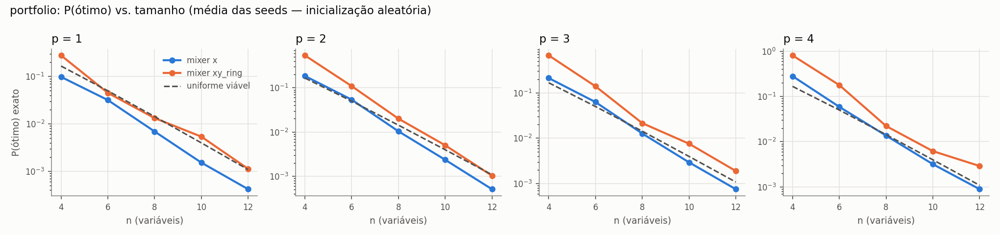
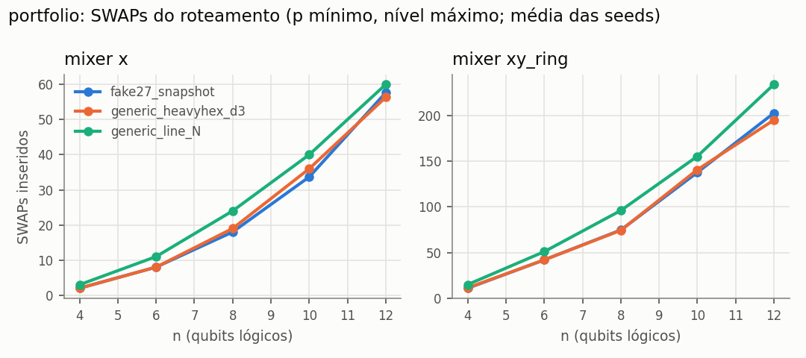
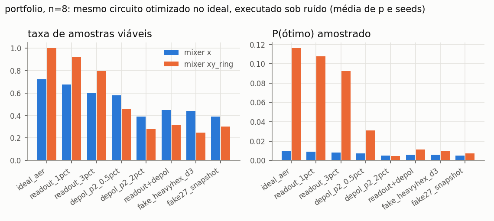

# 🔬 Quantum–Classical Optimization & Hardware-Aware Benchmark Lab — QAOA contra baselines clássicos no MESMO objetivo, da formulação ao circuito físico com ruído

### Python 3.10 · NumPy · SciPy · Pyomo + HiGHS · Qiskit 1.4 · qiskit-aer · qiskit-optimization · pytest · ruff · GitHub Actions

[](https://github.com/Yuri-Fernando/Projeto-Quantico-QAOA/actions/workflows/ci.yml)


 

---

## Status

🟡 **Em desenvolvimento — v0.3.0: laboratório hardware-aware em SIMULAÇÃO.** Benchmark de mesmo
objetivo, QAOA instrumentado (dois mixers), transpilation para backends fake, ruído, escala até n=20 e
um segundo domínio industrial — tudo executado localmente, com 179 testes passando (1 skip explícito de
GPU) e 10 execuções oficiais com manifesto em [`results/`](results/). **Não executado:** GPU (o
`qiskit-aer` instalado é só CPU, apesar da GPU NVIDIA no host), QPU real (`BLOCKED_BY_CONFIGURATION`:
sem `qiskit-ibm-runtime` nem credenciais) e o workflow de CI (só roda após push).

| Área | Estado | Evidência |
|---|---|---|
| Benchmark de mesmo objetivo | ✅ executado | E0: 50/50 instâncias com paridade f/QUBO/Ising/MILP ≤ 4,4e-16 |
| QAOA instrumentado (X+penalidade, XY+Dicke) | ✅ executado | E1/E1b/E1c/E4/E7, 10 seeds, ICs bootstrap |
| Transpilation e topologia | ✅ executado (fake backends) | E2: 960 transpilações aceitas pelo `Target` |
| Ruído | ✅ executado (Aer, fake backends) | E3: 8 regimes × 10 seeds × 4096 shots |
| GPU | ⛔ não executado | E5: `available_devices() == ('CPU',)` |
| QPU IBM | ⛔ bloqueado por configuração | E6: `not_executed`; adaptador testado com mocks |

---

## Descrição / Contexto

Laboratório de P&D que pergunta: **em que condições, para problemas discretos de alocação, escolhas de
ansatz, mixer, profundidade, medição, compilação e ruído alteram a qualidade, o custo e a viabilidade
de um workflow híbrido quando comparado a métodos clássicos que resolvem exatamente o mesmo problema?**

O problema é a seleção com cardinalidade e objetivo quadrático (`min xᵀQx` s.a. `Σx = k`), instanciado
em dois domínios sintéticos: **portfólio média-variância** (grafo de custo denso) e **seleção de tarefas
por turno com conflito de recursos** (grafo esparso). A v0.2.0 (LP, MILP, estocástico de 2 estágios,
Benders e QAOA) continua aqui como trilha separada de comparação de **modelos de risco**.

---

## 🧭 Origem do Projeto

1. **v0.1 (ago/2025)** — rascunho QUBO+QAOA com 4 ativos, preservado em [`legacy/v1/`](legacy/v1/).
2. **v0.2.0 (out/2026)** — laboratório comparativo LP/MILP/estocástico/Benders/QAOA sobre os mesmos dados.
3. **Auditoria técnica (2026-10-15)** apontou a lacuna decisiva: LP/MILP/Benders otimizavam
   retorno + *shortfall* e o QAOA otimizava média-variância — **objetivos diferentes**; o benchmark
   comparava formulações, não algoritmos. Também faltavam distribuição de amostras, viabilidade,
   QUBO auditável, topologia, ruído, escala, GPU/QPU com guardas e reprodutibilidade de engenharia.
4. **v0.3.0 (esta versão)** — implementação da auditoria na ordem de prioridade recomendada:
   P0 comparação correta → P1 ruído/conectividade/escala → P2 orquestração CPU/GPU/QPU → P3 segundo
   domínio e relatório. Plano rastreável em [`specs/hardware-aware-lab/`](specs/hardware-aware-lab/).

---

## 🎯 Objetivo

- Comparar algoritmos clássicos e QAOA sobre a **mesma** função-objetivo e as mesmas restrições, com
  paridade provada por teste;
- Reportar a distribuição de amostras do QAOA: viabilidade, P(ótimo), melhor solução viável, gap — e
  nunca uma solução com `Σx ≠ k`;
- Medir o custo de levar o circuito a topologias reais (SWAPs, portas 2Q, profundidade) e o efeito de ruído;
- Separar o que é ideal exato, amostrado, ruidoso, GPU e QPU — e registrar o que não foi executado;
- Sustentar inclusive a decisão de **não** adotar QAOA quando o clássico for superior.

---

## 🔬 Linha de Pesquisa / Desenvolvimento

Otimização combinatória quântica variacional (QAOA, mixers que preservam restrições, estados de Dicke),
compilação hardware-aware (layout, roteamento, conjunto nativo de portas), ruído e amostragem finita,
programação inteira mista como baseline exato (linearização de McCormick), heurísticas clássicas e
metodologia experimental (seeds, pseudo-réplicas, ICs, manifestos de execução).

---

## 🏗️ Arquitetura

```text
instância (portfolio | shift_scheduling)
   └─► CardinalityProblem (Q triangular, k, objective_id)        optimization/canonical_qubo.py
         ├─► MESMO objetivo, clássico                            optimization/classical_qubo.py, heuristics.py
         │     enumeração · MILP McCormick (HiGHS) · relaxação LP · simulated annealing · sorteio viável
         └─► QUBO(ρ) ─► Ising(h, J, offset) ─► SparsePauliOp
               └─► circuito QAOA: mixer X + penalidade | mixer XY + Dicke     quantum/ansatz.py
                     ├─► laço variacional CPU (simulação ideal exata)         quantum/runner.py, simulator.py
                     └─► backend                                              quantum/backends/
                           ├─ ideal_exact · Aer CPU/GPU · ruído · fake backend  quantum/noise.py, transpilation.py
                           └─ IBM QPU (--allow-qpu, orçamento, dry-run)
                     └─► métricas (viabilidade, P(ótimo), gap, Wilson)        quantum/measurement.py
pipeline com tempos por estágio e detecção de dispositivos                     hpc/
config YAML → manifest → records.jsonl + raw_counts → summary.md/figuras       experiments/
```

### Módulos

| Módulo | Função | Teste |
|---|---|---|
| `optimization/canonical_qubo.py` | problema canônico, QUBO, penalidade segura/crítica, Ising, ordem de bits | `test_qubo_equivalence.py` |
| `optimization/classical_qubo.py` | enumeração, MILP McCormick, relaxação LP | `test_milp_qubo_parity.py` |
| `optimization/heuristics.py` | simulated annealing (troca), sorteio viável | `test_milp_qubo_parity.py` |
| `optimization/instance.py`, `scheduling.py` | instâncias validadas e geradores (dois domínios) | `test_instance_generation.py`, `test_scheduling.py` |
| `optimization/lp,milp,stochastic,benders,qaoa.py` | trilha `model_comparison` (v0.2.0) | 14 testes originais |
| `quantum/ansatz.py`, `simulator.py` | circuito explícito, Dicke, simulador exato vetorizado | `test_ansatz.py` |
| `quantum/runner.py`, `measurement.py` | laço variacional, métricas e ICs | `test_feasibility.py`, `test_sampling_statistics.py` |
| `quantum/transpilation.py`, `noise.py` | métricas lógicas × físicas, regimes de ruído | `test_transpilation.py`, `test_noise_reproducibility.py` |
| `quantum/backends/` | `ExecutionResult`, Aer CPU/GPU, IBM QPU | `test_cpu_gpu_parity.py`, `test_qpu_mock_mode.py` |
| `hpc/` | dispositivos, profiling, orquestrador | `test_cpu_gpu_parity.py` |
| `experiments/` | CLI, manifest, análise, demo HTML | `test_experiments.py`, `test_demo.py` |

---

## ⚙️ Funcionamento

1. Gera-se uma instância (seed registrada) e o problema canônico com `objective_id`.
2. A enumeração certifica `f*` e o conjunto de ótimos; MILP, relaxação LP, SA e sorteio viável rodam no
   mesmo objetivo.
3. O QUBO (ρ exportado) vira Ising; o circuito QAOA é montado com o mixer escolhido.
4. O otimizador clássico ajusta `γ, β` sobre a simulação ideal exata (ou estimada por shots).
5. O circuito otimizado é executado no backend escolhido (ideal, Aer com ruído, fake com topologia, QPU
   com opt-in); as contagens viram métricas unificadas.
6. Cada execução grava manifest, registros e contagens; `experiments.analyze` gera tabelas e figuras
   somente desses dados.

```text
config.yaml ─► experiments.run ─► results/<exp>/<run_id>/{manifest.json, records.jsonl, raw_counts.jsonl.gz}
                                            └─► experiments.analyze ─► summary.md + figures/*.png
```

---

## 🧠 Verificação / Modelagem

| Camada | O que prova | Resultado |
|---|---|---|
| f × QUBO × Ising × `SparsePauliOp` (todas as bitstrings) | tradução sem erro de sinal, escala, offset ou ordem de bits | E0: 50/50, erro máx. 4,4e-16 |
| MILP McCormick × enumeração | baseline clássico exato do MESMO objetivo | E0 + `test_milp_qubo_parity`: iguais (≤ 1e-7) |
| Relaxação LP ≤ MILP | limite inferior válido no mesmo objetivo | 50/50 |
| Circuito Qiskit × simulador vetorizado | o simulador rápido implementa o mesmo unitário | fidelidade 1 ± 1e-10 |
| Dicke e mixer XY | preparação exata e peso de Hamming preservado | probabilidade fora de `Σx = k` < 1e-12 |
| ISA × `Target` | circuito compilado é executável no backend | 960/960 |
| Legado v1 | suspeita de dupla contagem da penalidade | **confirmada**: diferença exata `2ρ Σ_{i<j} x_i x_j` |

O oráculo é a enumeração combinatória, independente de qualquer solver. Formulação completa:
[`docs/MATHEMATICAL_FORMULATION.md`](docs/MATHEMATICAL_FORMULATION.md).

---

## 🧪 Desenvolvimento Experimental

**Achados reais (não plantados):**

1. **Dupla contagem no legado** — `build_qubo` somava `2ρ` em `Q[i,j]` e `Q[j,i]` de uma matriz lida
   como `xᵀQx` completa. Testado extraindo a função via `ast` (o arquivo não importa no Qiskit ≥ 1.0).
2. **Pseudo-replicação** — com inicialização determinística e objetivo exato, 10 seeds = 1 otimização;
   o IC saía artificialmente estreito. A análise remove réplicas idênticas (`indep.`) e as configs
   comparam inicialização fixa × aleatória.
3. **Bug do Qiskit 1.4.6** — `Layout.initial_index_layout(filter_ancillas=True)` levanta `IndexError`
   em um layout heavy-hex; derrubou E2/E3 na primeira rodada. Contornado com teste de regressão; as
   execuções falhas estão preservadas em [`results/_failed_runs/`](results/_failed_runs/).
4. **Hash de ruído instável** — `NoiseModel.to_dict()` inclui ids aleatórios; removidos do hash.
5. **Penalidade segura ≠ penalidade boa** — a crítica medida é 3,6% (portfólio) a 9,8% (escalonamento)
   da segura; reduzi-la aumenta P(ótimo) do mixer X (E1c).
6. **O trade-off só aparece com hardware no experimento** — o XY+Dicke vence no ideal, mas custa ~3,6×
   portas 2Q após roteamento e perde a vantagem sob ruído realista (E2/E3).

Decisão derivada: [`docs/adr/ADR-001-quando-nao-usar-qaoa.md`](docs/adr/ADR-001-quando-nao-usar-qaoa.md).

---

## 🛠️ Tecnologias

| Categoria | Stack |
|---|---|
| **Linguagem** | Python 3.10.8 |
| **Numérico / dados** | NumPy, SciPy, pandas, matplotlib, PyYAML |
| **Otimização clássica** | Pyomo + HiGHS (`appsi_highs`), `scipy.optimize.linprog` |
| **Quântico** | Qiskit 1.4.6, qiskit-aer 0.17.2, qiskit-optimization 0.7, qiskit-algorithms 0.4; qiskit-ibm-runtime opcional (não instalado) |
| **Qualidade** | pytest, ruff, GitHub Actions, lock de dependências (`requirements-lock.txt`) |

---

## 📊 Resultados

Todos os números abaixo vêm de execuções salvas em `results/` (commits `fc936b3`/`2b5c85f`, working tree
limpa). São **simulações em CPU**; nenhum envolve GPU ou QPU. Relatório completo:
[`docs/SCIENTIFIC_RESULTS.md`](docs/SCIENTIFIC_RESULTS.md).

**Qualidade no ideal (E1, portfólio).** `÷unif` = P(ótimo) exato ÷ probabilidade de sortear um ótimo
entre as `C(n,k)` seleções viáveis; inicialização aleatória, 30 otimizações independentes por célula.

| n | X p=1 | X p=4 | XY+Dicke p=1 | XY+Dicke p=4 |
|---|---|---|---|---|
| 4 | 0,59 | 1,69 | 1,68 | 4,85 |
| 8 | 0,48 | 0,95 | 0,93 | 1,55 |
| 12 | 0,39 | 0,82 | 1,04 | 2,67 |

**Compilação (E2, n=12, p=1, nível 3).** Portas 2Q lógicas → físicas: mixer X 66 → 132 (all-to-all) /
~260 (linha, heavy-hex 19q, snapshot 27q), ~57 SWAPs; XY+Dicke 203 → 537 / ~950, ~195–234 SWAPs.

**Ruído (E3, XY+Dicke p=2, 4096 shots, 10 seeds).** P(ótimo) por shot em n=8: ideal 0,169 → leitura 3%
0,133 → despolarizante p2=2% 0,004 → fake heavy-hex 0,010 → snapshot 27q 0,006 (sorteio uniforme: 0,014).

**Clássico (E1/E4/E7).** MILP McCormick `optimal` em todas as instâncias (0,05 s em n=8; 4,2 s em n=20);
simulated annealing achou o ótimo em 100% das execuções (≈0,1 s). Com 1024 amostras, o XY ideal só supera
o sorteio aleatório em n=14–16 (67–78% × 0%), ainda abaixo do SA.

**Leitura honesta:** nestas instâncias o baseline clássico de mesmo objetivo é superior em qualidade,
custo e garantia; a melhor variante quântica no ideal (XY) é a mais frágil sob ruído. Não há indício de
vantagem quântica — e o laboratório não foi construído para alegá-la.

---

## 🖼️ Evidências

<p align="center">
<a href="results/e1_ideal_qaoa/20261015T194733Z-6d86da/figures/p_opt_vs_n_portfolio.png"></a>
</p>
<p align="center"><sub>E1 — P(ótimo) exato vs. n por profundidade; tracejado = sorteio uniforme viável. Abaixo da linha, o
circuito concentra MENOS probabilidade no ótimo que um sorteio.</sub></p>

<p align="center">
<a href="results/e2_hardware_aware/20261015T213803Z-1830f6/figures/swaps_vs_n_portfolio.png"></a>
<a href="results/e3_noise/20261015T214030Z-2cac2f/figures/noise_portfolio_n8.png"></a>
</p>
<p align="center"><sub>E2 — SWAPs inseridos pelo roteamento por topologia. E3 — mesmo circuito (otimizado no ideal) executado
sob 8 regimes de ruído, n=8.</sub></p>

<p align="center">
<a href="legacy/v1/Captura%20de%20tela%202025-08-20%20131417.jpg"></a>
</p>
<p align="center"><sub>Peça histórica do rascunho v1 (ago/2025, instância de 4 ativos), não reexecutada.</sub></p>

---

## 🚀 Aplicações

- Banco de prova para avaliar, antes de gastar cota de QPU, se uma formulação QUBO/QAOA tem chance
  contra o baseline clássico do mesmo problema;
- Material de capacitação sobre QUBO, mixers, compilação, ruído e interpretação de "speedup"
  ([`docs/TRAINING_GUIDE.md`](docs/TRAINING_GUIDE.md));
- Esqueleto reutilizável para outros problemas de seleção/alocação com cardinalidade.

---

## 🔭 Visão de Longo Prazo

```text
v0.1  Rascunho QUBO+QAOA (ago/2025)
  ↓
v0.2  Comparação de MODELOS: LP/MILP/estocástico/Benders/QAOA (2026-10-07)
  ↓
v0.3  Benchmark de MESMO objetivo + hardware-aware em simulação (2026-10-15)  ← aqui
  ↓
v0.4  (planejado) otimização sob ruído, mitigação de erro, mixers de menor custo de compilação
  ↓
v0.5  (depende de recurso externo) GPU em host Linux; microexperimento em QPU autorizado
```

---

## 🗺️ Roadmap

Detalhe em [`ROADMAP.md`](ROADMAP.md) e [`specs/hardware-aware-lab/tasks.md`](specs/hardware-aware-lab/tasks.md).

- **F0 — Rascunho** ✅ Concluída — `legacy/v1/`.
- **F1 — Comparação de modelos** ✅ Concluída — v0.2.0, 14 testes (agora trilha `model_comparison`).
- **F2 — Benchmark justo e engenharia do QAOA** ✅ Concluída — E0/E1/E1b/E1c/E4/E7.
- **F3 — Hardware-aware em simulação** ✅ Concluída — E2/E3.
- **F4 — Recursos reais** ⏳ Planejada — GPU (Aer com CUDA), QPU com opt-in, primeira execução do CI.
- **F5 — Próximos experimentos** ⏳ Planejada — otimização sob ruído, mitigação, penalidade adaptativa.

---

## 🕓 Histórico e Mudanças

| Versão | Data | O que mudou |
|---|---|---|
| [0.1.0](CHANGELOG.md) | 2025-08-20 | Rascunho QUBO+QAOA (4 ativos). |
| [0.2.0](CHANGELOG.md) | 2026-10-07 | LP, MILP, estocástico, Benders e QAOA na mesma instância; 14 testes. |
| [0.3.0](CHANGELOG.md) | 2026-10-15 | Benchmark de mesmo objetivo, QAOA instrumentado, transpilation, ruído, GPU/QPU com guardas, escala, segundo domínio, experimentos E0–E7, CI, 166 testes novos. |

Log das sessões: [`WORKLOG.md`](WORKLOG.md).

---

## 🔮 Próximos Passos

**Concluído nesta versão:** todos os itens P0/P1 da auditoria e as partes de P2/P3 executáveis
localmente — ver [`specs/hardware-aware-lab/tasks.md`](specs/hardware-aware-lab/tasks.md).

**Dependem de recurso externo (decisão do proprietário):**
- GPU: host Linux com `qiskit-aer-gpu` + CUDA para rodar E5 de verdade;
- QPU: `qiskit-ibm-runtime`, credenciais e orçamento para E6 (dry-run primeiro);
- Licença: não definida — escolha consciente conforme estratégia de publicação.

**Próximos técnicos:** otimização variacional sob ruído; mitigação de erro de leitura com overhead
medido; XY em pares paralelos (menor profundidade); penalidade adaptativa perto da crítica.

---

## ▶️ Como rodar localmente

Pré-requisitos: Python 3.10; ambiente limpo recomendado (não misture Qiskit < 1.0 e ≥ 1.0).

```bash
python -m venv .venv
.venv\Scripts\activate                   # Windows  (Linux/Mac: source .venv/bin/activate)
pip install -r requirements-lock.txt     # versões exatas testadas
pip install -r requirements.txt

python -m ruff check .                   # lint
python -m pytest -q -rs                  # 179 passed, 1 skipped (GPU) nesta máquina

# experimentos (cada um cria results/<exp>/<run_id>/ com manifest, registros e summary.md)
python -m experiments.run --config experiments/configs/e0_equivalence.yaml
python -m experiments.run --config experiments/configs/e1_ideal_qaoa.yaml --quick   # versão rápida
python -m benchmarks.fair_qubo_benchmark       # = E1 (trilha algorithm_benchmark)
python -m benchmarks.compare_methods           # trilha model_comparison (v0.2.0)

# demonstrador de 5 passos -> relatório HTML estático
python -m experiments.demo --n 6 --mixer xy_ring --p 2 --backend fake --out demo.html
```

| Ambiente | Situação |
|---|---|
| Windows 11, Python 3.10.8, CPU | testado nesta revisão (testes, lint, E0–E7, demo) |
| Ubuntu (GitHub Actions) | workflow escrito; ainda não executado |
| GPU | requer `qiskit-aer` com CUDA (Linux); não testado |
| QPU IBM | requer `pip install .[qpu]`, `QISKIT_IBM_TOKEN` e `--allow-qpu`; não testado |

Tempo de parede das execuções completas nesta máquina: de segundos (E0, E5) a ~15 min (E4); ver
`wall_time_s` em cada `manifest.json`.

---

## 📁 Estrutura do repositório

```text
optimization/     problema canônico, baselines exatos, heurísticas, domínios; trilha model_comparison (v0.2.0)
quantum/          ansatz, simulador exato, runner, medição, transpilation, ruído, backends, recursos
hpc/              detecção de dispositivos, profiling, orquestrador híbrido
experiments/      run (CLI), schemas (manifest), analyze, demo, configs/E0–E7
benchmarks/       compare_methods (model_comparison), fair_qubo_benchmark, scalability, archive/v0.2.0
results/          execuções oficiais E0–E7 (+ _failed_runs/ com as que não completaram)
tests/            180 testes (14 originais da v0.2.0)
docs/             formulação, protocolo, arquitetura, limitações, relatório, ADR, guia
specs/            spec, design e tasks desta versão
reports/          template de relatório de experimento
legacy/v1/        rascunho original (não executável no Qiskit ≥ 1.0), movido com git mv
tools/            lock_deps.py
```

Não versionado: caches (`__pycache__`, `.pytest_cache`, `.ruff_cache`), logs locais de execução e as
contagens brutas das execuções que falharam.

---

## 📚 Documentação

| Documento | Conteúdo |
|---|---|
| [docs/MATHEMATICAL_FORMULATION.md](docs/MATHEMATICAL_FORMULATION.md) | Problema canônico, QUBO, penalidades, Ising, McCormick, Dicke/XY |
| [docs/EXPERIMENT_PROTOCOL.md](docs/EXPERIMENT_PROTOCOL.md) | Regras, E0–E7, manifesto, ameaças à validade |
| [docs/SCIENTIFIC_RESULTS.md](docs/SCIENTIFIC_RESULTS.md) | Relatório técnico com hipóteses, resultados e conclusão |
| [docs/ARCHITECTURE.md](docs/ARCHITECTURE.md) | Componentes, contrato de execução, decisões |
| [docs/HARDWARE_LIMITATIONS.md](docs/HARDWARE_LIMITATIONS.md) | GPU, QPU, fake backends, memória, bugs de bibliotecas |
| [docs/adr/ADR-001-quando-nao-usar-qaoa.md](docs/adr/ADR-001-quando-nao-usar-qaoa.md) | Decisão técnica baseada nos experimentos |
| [docs/TRAINING_GUIDE.md](docs/TRAINING_GUIDE.md) | Mini-guia de 20–30 min |
| [CHANGELOG.md](CHANGELOG.md) · [ROADMAP.md](ROADMAP.md) · [WORKLOG.md](WORKLOG.md) | Histórico, plano, log |

---

## ⚠️ Limitações

- **Só simulação clássica.** Nenhum resultado em GPU ou QPU; os rótulos `is_real_hardware`/`device`
  de cada registro mostram isso.
- **Escala pequena e dados sintéticos.** Qualidade medida até n=12 (E1/E7) e n=20 (E4, p=1); nada deve
  ser extrapolado.
- **Backends fake** têm erros sintéticos (`GenericBackendV2`) ou um snapshot antigo e deprecated
  (`Fake27QPulseV1`); não representam a calibração atual de nenhum dispositivo.
- **Ruído por transferência**: os parâmetros são otimizados no ideal; otimização sob ruído não foi feita.
- **Adaptador de QPU** nunca falou com o serviço real; a API do Runtime precisa ser conferida na versão
  que for instalada.
- **CI** não foi executado (sem push nesta revisão). **Licença** não definida.
- O `legacy/v1/` não roda no ambiente atual (preservado como histórico).

---

## Status

🟡 **Em desenvolvimento — v0.3.0.** Benchmark de mesmo objetivo e estudo hardware-aware executados em
simulação CPU, com 179 testes passando; GPU, QPU e CI dependem de recurso externo e estão registrados
como não executados.

---

## Contexto / Observações

Peça de portfólio pessoal de P&D, não afiliada a instituição financeira, fabricante de hardware ou
provedor de nuvem quântica. Tickers da v0.2.0 (PETR4, VALE3, ITUB4) são rótulos ilustrativos; todos os
dados são sintéticos com seed registrada; nada aqui é recomendação de investimento. Os números vêm de
execuções medidas nesta máquina e salvas no repositório — não de estimativas de ferramentas. Nenhuma
publicação, parceria ou propriedade intelectual é alegada.

---

## 🔗 Projetos Relacionados

| Projeto | Relação |
|---|---|
| [ArgusAI](https://github.com/Yuri-Fernando) | Mesmo portfólio pessoal; sem integração técnica |

---

## 🤖 Autor

**Yuri Fernando Dubbern**

Engenharia Elétrica · Ciência da Computação · Inteligência Artificial ·
Sistemas Embarcados · Projeto de Hardware · Pesquisa e Desenvolvimento

[LinkedIn](https://www.linkedin.com/in/yuridubbern) · [GitHub](https://github.com/Yuri-Fernando) · [Lattes](http://lattes.cnpq.br/7151392692642166) · [Linktree](https://linktr.ee/yuri.f.dubbern)

---

## Licença

Nenhuma licença formal definida neste repositório (sem arquivo `LICENSE`) — escolha pendente do
proprietário. Uso, redistribuição ou reuso comercial não autorizados sem contato prévio com o autor.
