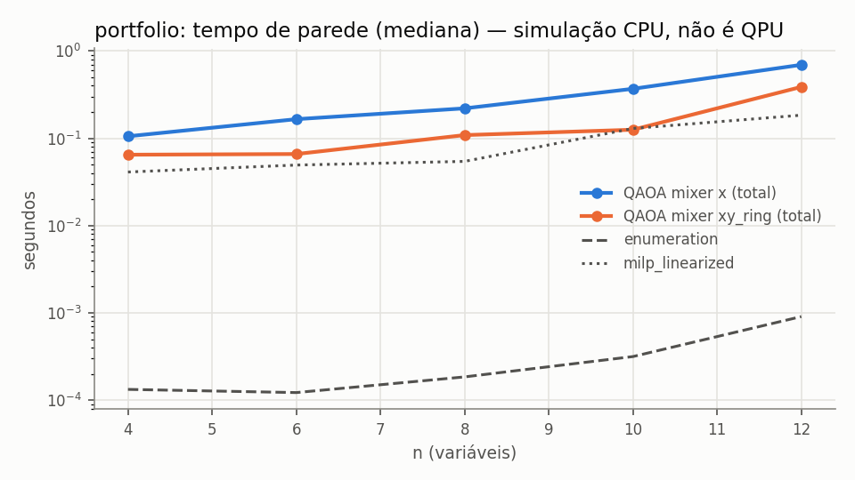

# e1_ideal_qaoa — resumo gerado de `records.jsonl`

- run_id: `20261015T194733Z-6d86da` · kind: `algorithm_benchmark` · track: `algorithm_benchmark`
- commit: `fc936b306ae185aba003a6ff2933b24877c54ceb` (working tree suja: False)
- config_hash: `d9015542084e1d35` · registros: 2745 · tempo de parede: 588.6s · modo quick: False
- Python 3.10.8 · qiskit 1.4.6 · qiskit-aer 0.17.2 · GPU: host_has_nvidia_gpu_but_qiskit_aer_build_is_cpu_only
- Toda execução quântica aqui é SIMULAÇÃO em CPU (`is_real_hardware=false`), salvo indicação explícita.
### Baselines clássicos (mesmo objetivo)

| domain | n | algorithm | runs | taxa_ótimo | gap_abs_médio | P(ótimo)_amostra | tempo_s_médio |
|---|---|---|---|---|---|---|---|
| portfolio | 4 | enumeration | 3 | 1.0000 | 0.0000 | — | 2.02e-04 |
| portfolio | 4 | lp_relaxation_mccormick | 3 | — | — | — | 0.0448 |
| portfolio | 4 | milp_linearized | 3 | 1.0000 | -5.78e-19 | — | 0.0747 |
| portfolio | 4 | random_feasible_sampling | 30 | 1.0000 | 0.0000 | 0.1685 | 0.0146 |
| portfolio | 4 | simulated_annealing | 30 | 1.0000 | -5.78e-19 | — | 0.0852 |
| portfolio | 6 | enumeration | 3 | 1.0000 | 0.0000 | — | 1.33e-04 |
| portfolio | 6 | lp_relaxation_mccormick | 3 | — | — | — | 0.0267 |
| portfolio | 6 | milp_linearized | 3 | 1.0000 | 0.0000 | — | 0.0491 |
| portfolio | 6 | random_feasible_sampling | 30 | 1.0000 | 0.0000 | 0.0495 | 0.0145 |
| portfolio | 6 | simulated_annealing | 30 | 1.0000 | 0.0000 | — | 0.0839 |
| portfolio | 8 | enumeration | 3 | 1.0000 | 0.0000 | — | 1.82e-04 |
| portfolio | 8 | lp_relaxation_mccormick | 3 | — | — | — | 0.0297 |
| portfolio | 8 | milp_linearized | 3 | 1.0000 | -5.78e-19 | — | 0.0634 |
| portfolio | 8 | random_feasible_sampling | 30 | 1.0000 | 0.0000 | 0.0136 | 0.0142 |
| portfolio | 8 | simulated_annealing | 30 | 1.0000 | -5.78e-19 | — | 0.0842 |
| portfolio | 10 | enumeration | 3 | 1.0000 | 0.0000 | — | 3.24e-04 |
| portfolio | 10 | lp_relaxation_mccormick | 3 | — | — | — | 0.0440 |
| portfolio | 10 | milp_linearized | 3 | 1.0000 | 0.0000 | — | 0.1250 |
| portfolio | 10 | random_feasible_sampling | 30 | 1.0000 | 0.0000 | 0.0041 | 0.0148 |
| portfolio | 10 | simulated_annealing | 30 | 1.0000 | 0.0000 | — | 0.0840 |
| portfolio | 12 | enumeration | 3 | 1.0000 | 0.0000 | — | 0.0010 |
| portfolio | 12 | lp_relaxation_mccormick | 3 | — | — | — | 0.0402 |
| portfolio | 12 | milp_linearized | 3 | 1.0000 | 1.16e-18 | — | 0.1748 |
| portfolio | 12 | random_feasible_sampling | 30 | 0.7333 | 4.26e-04 | 0.0011 | 0.0152 |
| portfolio | 12 | simulated_annealing | 30 | 1.0000 | 1.16e-18 | — | 0.0861 |

### QAOA (simulação ideal exata + amostragem finita)

`÷ uniforme viável` = P(ótimo) exato dividido pela probabilidade de sortear um ótimo uniformemente entre as C(n,k) seleções viáveis (baseline aleatório). Valores ≤ 1 significam que o circuito não concentrou probabilidade no ótimo. `runs` = execuções; `indep.` = otimizações distintas (pseudo-réplicas removidas das métricas exatas e do IC). `melhor amostra ótima` = fração de execuções cuja melhor amostra viável é ótima — compare com `random_feasible_sampling`, que usa o MESMO número de amostras.

| domain | n | algorithm | p | init_strategy | runs | indep. | P(ótimo) exato [IC95] | ÷ uniforme viável | P(viável) exato | melhor amostra ótima | avaliações | tempo_total_s |
|---|---|---|---|---|---|---|---|---|---|---|---|---|
| portfolio | 4 | qaoa_x | 1 | linear_ramp | 30 | 3 | 0.0296 [0.0032, 0.0571] | 0.1777 | 0.1675 | 1.0000 | 135.6667 | 0.0320 |
| portfolio | 4 | qaoa_x | 1 | random | 30 | 30 | 0.0984 [0.0762, 0.1209] | 0.5902 | 0.5248 | 1.0000 | 57.2333 | 0.0147 |
| portfolio | 4 | qaoa_x | 2 | linear_ramp | 30 | 3 | 0.1465 [0.1308, 0.1580] | 0.8788 | 0.8620 | 1.0000 | 300 | 0.1039 |
| portfolio | 4 | qaoa_x | 2 | random | 30 | 30 | 0.1854 [0.1500, 0.2245] | 1.1123 | 0.7316 | 1.0000 | 176.6000 | 0.0629 |
| portfolio | 4 | qaoa_x | 3 | linear_ramp | 30 | 3 | 0.2230 [0.2060, 0.2320] | 1.3382 | 0.9439 | 1.0000 | 300 | 0.1452 |
| portfolio | 4 | qaoa_x | 3 | random | 30 | 30 | 0.2114 [0.1693, 0.2549] | 1.2682 | 0.7751 | 1.0000 | 293.1000 | 0.1384 |
| portfolio | 4 | qaoa_x | 4 | linear_ramp | 30 | 3 | 0.2358 [0.1833, 0.3096] | 1.4147 | 0.9555 | 1.0000 | 300 | 0.1835 |
| portfolio | 4 | qaoa_x | 4 | random | 30 | 30 | 0.2810 [0.2381, 0.3276] | 1.6857 | 0.8606 | 1.0000 | 300 | 0.1823 |
| portfolio | 4 | qaoa_xy_ring | 1 | linear_ramp | 30 | 3 | 0.5485 [0.3868, 0.8186] | 3.2913 | 1.0000 | 1.0000 | 42.3333 | 0.0085 |
| portfolio | 4 | qaoa_xy_ring | 1 | random | 30 | 30 | 0.2799 [0.2310, 0.3354] | 1.6792 | 1.0000 | 1.0000 | 76.4667 | 0.0130 |
| portfolio | 4 | qaoa_xy_ring | 2 | linear_ramp | 30 | 3 | 0.5788 [0.4569, 0.7644] | 3.4728 | 1.0000 | 1.0000 | 281.6667 | 0.0612 |
| portfolio | 4 | qaoa_xy_ring | 2 | random | 30 | 30 | 0.5414 [0.4705, 0.6090] | 3.2487 | 1.0000 | 1.0000 | 215.7667 | 0.0456 |
| portfolio | 4 | qaoa_xy_ring | 3 | linear_ramp | 30 | 3 | 0.7339 [0.6395, 0.9207] | 4.4034 | 1.0000 | 1.0000 | 300 | 0.0841 |
| portfolio | 4 | qaoa_xy_ring | 3 | random | 30 | 30 | 0.6682 [0.5787, 0.7509] | 4.0093 | 1.0000 | 1.0000 | 296.8000 | 0.0833 |
| portfolio | 4 | qaoa_xy_ring | 4 | linear_ramp | 30 | 3 | 0.8048 [0.6403, 0.9270] | 4.8290 | 1.0000 | 1.0000 | 300 | 0.1027 |
| portfolio | 4 | qaoa_xy_ring | 4 | random | 30 | 30 | 0.8077 [0.7437, 0.8659] | 4.8461 | 1.0000 | 1.0000 | 300 | 0.1050 |
| portfolio | 6 | qaoa_x | 1 | linear_ramp | 30 | 3 | 0.0247 [0.0222, 0.0262] | 0.4946 | 0.6686 | 1.0000 | 43 | 0.0177 |
| portfolio | 6 | qaoa_x | 1 | random | 30 | 30 | 0.0319 [0.0262, 0.0378] | 0.6378 | 0.5507 | 1.0000 | 118.5000 | 0.0380 |
| portfolio | 6 | qaoa_x | 2 | linear_ramp | 30 | 3 | 0.0448 [0.0354, 0.0499] | 0.8966 | 0.9146 | 1.0000 | 270.3333 | 0.1280 |
| portfolio | 6 | qaoa_x | 2 | random | 30 | 30 | 0.0539 [0.0461, 0.0626] | 1.0788 | 0.7728 | 1.0000 | 215.9000 | 0.1042 |
| portfolio | 6 | qaoa_x | 3 | linear_ramp | 30 | 3 | 0.0512 [0.0507, 0.0517] | 1.0234 | 0.9747 | 1.0000 | 300 | 0.2016 |
| portfolio | 6 | qaoa_x | 3 | random | 30 | 30 | 0.0626 [0.0435, 0.0854] | 1.2518 | 0.7559 | 1.0000 | 298.7667 | 0.2025 |
| portfolio | 6 | qaoa_x | 4 | linear_ramp | 30 | 3 | 0.0468 [0.0463, 0.0470] | 0.9350 | 0.9598 | 1.0000 | 300 | 0.2580 |
| portfolio | 6 | qaoa_x | 4 | random | 30 | 30 | 0.0588 [0.0465, 0.0718] | 1.1762 | 0.8348 | 1.0000 | 298.9667 | 0.2608 |
| portfolio | 6 | qaoa_xy_ring | 1 | linear_ramp | 30 | 3 | 0.1815 [0.0183, 0.4437] | 3.6297 | 1.0000 | 1.0000 | 39.3333 | 0.0106 |
| portfolio | 6 | qaoa_xy_ring | 1 | random | 30 | 30 | 0.0452 [0.0225, 0.0800] | 0.9034 | 1.0000 | 1.0000 | 45.5000 | 0.0114 |
| portfolio | 6 | qaoa_xy_ring | 2 | linear_ramp | 30 | 3 | 0.3424 [0.1638, 0.5851] | 6.8486 | 1.0000 | 1.0000 | 221.6667 | 0.0630 |
| portfolio | 6 | qaoa_xy_ring | 2 | random | 30 | 30 | 0.1094 [0.0741, 0.1498] | 2.1872 | 1.0000 | 1.0000 | 156.0667 | 0.0448 |
| portfolio | 6 | qaoa_xy_ring | 3 | linear_ramp | 30 | 3 | 0.2867 [0.0626, 0.6576] | 5.7348 | 1.0000 | 1.0000 | 260 | 0.0980 |
| portfolio | 6 | qaoa_xy_ring | 3 | random | 30 | 30 | 0.1393 [0.1001, 0.1827] | 2.7855 | 1.0000 | 1.0000 | 242.1000 | 0.0913 |
| portfolio | 6 | qaoa_xy_ring | 4 | linear_ramp | 30 | 3 | 0.2570 [0.0416, 0.6040] | 5.1402 | 1.0000 | 1.0000 | 300 | 0.1433 |
| portfolio | 6 | qaoa_xy_ring | 4 | random | 30 | 30 | 0.1780 [0.1364, 0.2247] | 3.5591 | 1.0000 | 1.0000 | 289.6333 | 0.1387 |
| portfolio | 8 | qaoa_x | 1 | linear_ramp | 30 | 3 | 0.0088 [0.0068, 0.0123] | 0.6161 | 0.6259 | 1.0000 | 38.3333 | 0.0299 |
| portfolio | 8 | qaoa_x | 1 | random | 30 | 30 | 0.0069 [0.0057, 0.0081] | 0.4841 | 0.5083 | 0.9333 | 99.7333 | 0.0525 |
| portfolio | 8 | qaoa_x | 2 | linear_ramp | 30 | 3 | 0.0135 [0.0132, 0.0136] | 0.9448 | 0.8232 | 1.0000 | 113 | 0.0837 |
| portfolio | 8 | qaoa_x | 2 | random | 30 | 30 | 0.0104 [0.0091, 0.0117] | 0.7269 | 0.6876 | 1.0000 | 241.1333 | 0.1656 |
| portfolio | 8 | qaoa_x | 3 | linear_ramp | 30 | 3 | 0.0118 [0.0116, 0.0120] | 0.8267 | 0.8538 | 1.0000 | 300 | 0.2858 |
| portfolio | 8 | qaoa_x | 3 | random | 30 | 30 | 0.0127 [0.0106, 0.0149] | 0.8886 | 0.7328 | 1.0000 | 296.9667 | 0.2818 |
| portfolio | 8 | qaoa_x | 4 | linear_ramp | 30 | 3 | 0.0164 [0.0158, 0.0167] | 1.1464 | 0.9525 | 1.0000 | 300 | 0.3628 |
| portfolio | 8 | qaoa_x | 4 | random | 30 | 30 | 0.0136 [0.0119, 0.0154] | 0.9505 | 0.8172 | 1.0000 | 298.2000 | 0.3633 |
| portfolio | 8 | qaoa_xy_ring | 1 | linear_ramp | 30 | 3 | 0.0458 [0.0226, 0.0657] | 3.2086 | 1.0000 | 1.0000 | 100 | 0.0296 |
| portfolio | 8 | qaoa_xy_ring | 1 | random | 30 | 30 | 0.0133 [0.0092, 0.0187] | 0.9288 | 1.0000 | 1.0000 | 98.4000 | 0.0288 |
| portfolio | 8 | qaoa_xy_ring | 2 | linear_ramp | 30 | 3 | 0.0948 [0.0293, 0.1710] | 6.6346 | 1.0000 | 1.0000 | 246 | 0.0926 |
| portfolio | 8 | qaoa_xy_ring | 2 | random | 30 | 30 | 0.0201 [0.0147, 0.0267] | 1.4045 | 1.0000 | 0.8667 | 161.6333 | 0.0646 |
| portfolio | 8 | qaoa_xy_ring | 3 | linear_ramp | 30 | 3 | 0.1050 [0.0119, 0.2086] | 7.3468 | 1.0000 | 1.0000 | 293.3333 | 0.1503 |
| portfolio | 8 | qaoa_xy_ring | 3 | random | 30 | 30 | 0.0215 [0.0151, 0.0292] | 1.5031 | 1.0000 | 0.9333 | 262.4667 | 0.1362 |
| portfolio | 8 | qaoa_xy_ring | 4 | linear_ramp | 30 | 3 | 0.1424 [0.0028, 0.3423] | 9.9674 | 1.0000 | 0.9667 | 300 | 0.1952 |
| portfolio | 8 | qaoa_xy_ring | 4 | random | 30 | 30 | 0.0222 [0.0155, 0.0299] | 1.5507 | 1.0000 | 1.0000 | 293.0333 | 0.1896 |
| portfolio | 10 | qaoa_x | 1 | linear_ramp | 30 | 3 | 0.0020 [0.0019, 0.0020] | 0.4948 | 0.5994 | 0.9667 | 69.3333 | 0.0806 |
| portfolio | 10 | qaoa_x | 1 | random | 30 | 30 | 0.0015 [0.0012, 0.0018] | 0.3828 | 0.3884 | 0.7333 | 85.6000 | 0.0905 |
| portfolio | 10 | qaoa_x | 2 | linear_ramp | 30 | 3 | 0.0022 [0.0022, 0.0022] | 0.5507 | 0.5607 | 0.9667 | 148.3333 | 0.1870 |
| portfolio | 10 | qaoa_x | 2 | random | 30 | 30 | 0.0023 [0.0020, 0.0027] | 0.5920 | 0.5938 | 0.9333 | 238.8333 | 0.2675 |
| portfolio | 10 | qaoa_x | 3 | linear_ramp | 30 | 3 | 0.0028 [0.0028, 0.0028] | 0.7028 | 0.6057 | 1.0000 | 300 | 0.4604 |
| portfolio | 10 | qaoa_x | 3 | random | 30 | 30 | 0.0029 [0.0025, 0.0034] | 0.7410 | 0.6350 | 0.9667 | 297.8667 | 0.4476 |
| portfolio | 10 | qaoa_x | 4 | linear_ramp | 30 | 3 | 0.0033 [0.0027, 0.0036] | 0.8230 | 0.8169 | 1.0000 | 300 | 0.5682 |
| portfolio | 10 | qaoa_x | 4 | random | 30 | 30 | 0.0032 [0.0026, 0.0038] | 0.7997 | 0.6843 | 0.9333 | 300 | 0.5718 |
| portfolio | 10 | qaoa_xy_ring | 1 | linear_ramp | 30 | 3 | 0.0025 [0.0002, 0.0061] | 0.6209 | 1.0000 | 0.8000 | 37 | 0.0347 |
| portfolio | 10 | qaoa_xy_ring | 1 | random | 30 | 30 | 0.0054 [0.0041, 0.0068] | 1.3541 | 1.0000 | 0.9000 | 57.5333 | 0.0420 |
| portfolio | 10 | qaoa_xy_ring | 2 | linear_ramp | 30 | 3 | 0.0114 [0.0037, 0.0232] | 2.8663 | 1.0000 | 1.0000 | 110 | 0.0828 |
| portfolio | 10 | qaoa_xy_ring | 2 | random | 30 | 30 | 0.0050 [0.0035, 0.0068] | 1.2616 | 1.0000 | 0.8667 | 143.3000 | 0.1043 |
| portfolio | 10 | qaoa_xy_ring | 3 | linear_ramp | 30 | 3 | 0.0018 [0.0004, 0.0027] | 0.4514 | 1.0000 | 0.8000 | 241.6667 | 0.2147 |
| portfolio | 10 | qaoa_xy_ring | 3 | random | 30 | 30 | 0.0076 [0.0058, 0.0095] | 1.9080 | 1.0000 | 0.9667 | 204 | 0.1859 |
| portfolio | 10 | qaoa_xy_ring | 4 | linear_ramp | 30 | 3 | 0.0057 [0.0038, 0.0075] | 1.4247 | 1.0000 | 1.0000 | 270 | 0.3008 |
| portfolio | 10 | qaoa_xy_ring | 4 | random | 30 | 30 | 0.0062 [0.0041, 0.0086] | 1.5541 | 1.0000 | 0.9333 | 265.0667 | 0.3029 |
| portfolio | 12 | qaoa_x | 1 | linear_ramp | 30 | 3 | 0.0002 [0.0002, 0.0003] | 0.2273 | 0.2259 | 0.1333 | 45.3333 | 0.1431 |
| portfolio | 12 | qaoa_x | 1 | random | 30 | 30 | 0.0004 [0.0003, 0.0005] | 0.3856 | 0.3911 | 0.3000 | 85.0667 | 0.1799 |
| portfolio | 12 | qaoa_x | 2 | linear_ramp | 30 | 3 | 0.0006 [0.0006, 0.0006] | 0.5263 | 0.5577 | 0.4667 | 158.6667 | 0.3946 |
| portfolio | 12 | qaoa_x | 2 | random | 30 | 30 | 0.0005 [0.0004, 0.0006] | 0.4696 | 0.4599 | 0.3000 | 262.3333 | 0.5931 |
| portfolio | 12 | qaoa_x | 3 | linear_ramp | 30 | 3 | 0.0005 [0.0001, 0.0009] | 0.4834 | 0.4828 | 0.3667 | 300 | 0.9309 |
| portfolio | 12 | qaoa_x | 3 | random | 30 | 30 | 0.0008 [0.0006, 0.0009] | 0.6954 | 0.6121 | 0.6000 | 294.3667 | 0.9200 |
| portfolio | 12 | qaoa_x | 4 | linear_ramp | 30 | 3 | 0.0004 [0.0003, 0.0004] | 0.3636 | 0.4629 | 0.3000 | 300 | 1.2043 |
| portfolio | 12 | qaoa_x | 4 | random | 30 | 30 | 0.0009 [0.0007, 0.0011] | 0.8205 | 0.6479 | 0.4333 | 300 | 1.2054 |
| portfolio | 12 | qaoa_xy_ring | 1 | linear_ramp | 30 | 3 | 0.0016 [0.0003, 0.0038] | 1.5123 | 1.0000 | 0.7000 | 49.3333 | 0.1025 |
| portfolio | 12 | qaoa_xy_ring | 1 | random | 30 | 30 | 0.0011 [0.0009, 0.0014] | 1.0385 | 1.0000 | 0.6333 | 99.3667 | 0.1359 |
| portfolio | 12 | qaoa_xy_ring | 2 | linear_ramp | 30 | 3 | 0.0026 [0.0002, 0.0056] | 2.4017 | 1.0000 | 0.6333 | 138.3333 | 0.2319 |
| portfolio | 12 | qaoa_xy_ring | 2 | random | 30 | 30 | 0.0010 [0.0006, 0.0015] | 0.9481 | 1.0000 | 0.4667 | 156.5000 | 0.2688 |
| portfolio | 12 | qaoa_xy_ring | 3 | linear_ramp | 30 | 3 | 0.0011 [0.0000, 0.0032] | 1.0371 | 1.0000 | 0.3333 | 300 | 0.6186 |
| portfolio | 12 | qaoa_xy_ring | 3 | random | 30 | 30 | 0.0019 [0.0009, 0.0034] | 1.7522 | 1.0000 | 0.5333 | 234.8000 | 0.5083 |
| portfolio | 12 | qaoa_xy_ring | 4 | linear_ramp | 30 | 3 | 0.0141 [0.0006, 0.0402] | 13.0228 | 1.0000 | 0.7000 | 300 | 0.8127 |
| portfolio | 12 | qaoa_xy_ring | 4 | random | 30 | 30 | 0.0029 [0.0016, 0.0047] | 2.6713 | 1.0000 | 0.6667 | 266.5333 | 0.7422 |

### Recursos (QAOA)

| domain | n | algorithm | runs | statevector_teórico_MB | pico_tracemalloc_MB | tempo_otimização_s | 2Q_lógicas_total |
|---|---|---|---|---|---|---|---|
| portfolio | 4 | qaoa_x | 240 | 2.44e-04 | 0.0567 | 0.1047 | 15 |
| portfolio | 4 | qaoa_xy_ring | 240 | 2.44e-04 | 0.0180 | 0.0602 | 35 |
| portfolio | 6 | qaoa_x | 240 | 9.77e-04 | 0.0841 | 0.1455 | 37.5000 |
| portfolio | 6 | qaoa_xy_ring | 240 | 9.77e-04 | 0.0878 | 0.0712 | 67.5000 |
| portfolio | 8 | qaoa_x | 240 | 0.0039 | 0.3012 | 0.1877 | 70 |
| portfolio | 8 | qaoa_xy_ring | 240 | 0.0039 | 0.3039 | 0.1026 | 110 |
| portfolio | 10 | qaoa_x | 240 | 0.0156 | 0.3863 | 0.2900 | 112.5000 |
| portfolio | 10 | qaoa_xy_ring | 240 | 0.0156 | 0.4666 | 0.1358 | 162.5000 |
| portfolio | 12 | qaoa_x | 240 | 0.0625 | 0.9481 | 0.6076 | 165 |
| portfolio | 12 | qaoa_xy_ring | 240 | 0.0625 | 1.3252 | 0.3690 | 225 |

