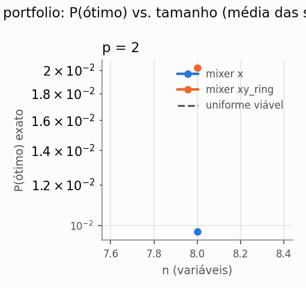
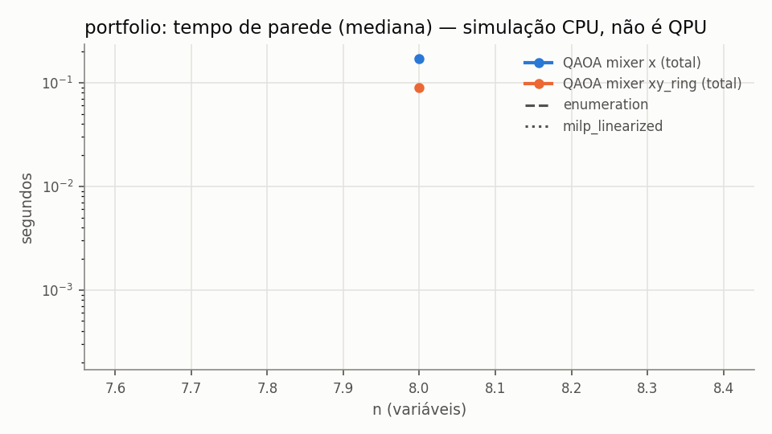

# e1b_optimizers_shots — resumo gerado de `records.jsonl`

- run_id: `20261015T192646Z-e5731e` · kind: `algorithm_benchmark` · track: `algorithm_benchmark`
- commit: `fc936b306ae185aba003a6ff2933b24877c54ceb` (working tree suja: False)
- config_hash: `6e68dd520d5da9d6` · registros: 1450 · tempo de parede: 160.8s · modo quick: False
- Python 3.10.8 · qiskit 1.4.6 · qiskit-aer 0.17.2 · GPU: host_has_nvidia_gpu_but_qiskit_aer_build_is_cpu_only
- Toda execução quântica aqui é SIMULAÇÃO em CPU (`is_real_hardware=false`), salvo indicação explícita.
### Baselines clássicos (mesmo objetivo)

| domain | n | algorithm | runs | taxa_ótimo | gap_abs_médio | P(ótimo)_amostra | tempo_s_médio |
|---|---|---|---|---|---|---|---|
| portfolio | 8 | enumeration | 2 | 1.0000 | 0.0000 | — | 2.35e-04 |
| portfolio | 8 | lp_relaxation_mccormick | 2 | — | — | — | 0.0294 |
| portfolio | 8 | milp_linearized | 2 | 1.0000 | 0.0000 | — | 0.1178 |
| portfolio | 8 | random_feasible_sampling | 2 | 1.0000 | 0.0000 | 0.0137 | 0.0150 |
| portfolio | 8 | simulated_annealing | 2 | 1.0000 | 0.0000 | — | 0.0844 |

### QAOA (simulação ideal exata + amostragem finita)

`÷ uniforme viável` = P(ótimo) exato dividido pela probabilidade de sortear um ótimo uniformemente entre as C(n,k) seleções viáveis (baseline aleatório). Valores ≤ 1 significam que o circuito não concentrou probabilidade no ótimo. `runs` = execuções; `indep.` = otimizações distintas (pseudo-réplicas removidas das métricas exatas e do IC). `melhor amostra ótima` = fração de execuções cuja melhor amostra viável é ótima — compare com `random_feasible_sampling`, que usa o MESMO número de amostras.

| domain | n | algorithm | p | optimizer | init_strategy | objective_mode | shots | runs | indep. | P(ótimo) exato [IC95] | ÷ uniforme viável | P(viável) exato | melhor amostra ótima | avaliações | tempo_total_s |
|---|---|---|---|---|---|---|---|---|---|---|---|---|---|---|---|
| portfolio | 8 | qaoa_x | 2 | cobyla | linear_ramp | exact | 256 | 20 | 2 | 0.0136 [0.0136, 0.0136] | 0.9538 | 0.8219 | 0.9500 | 104.5000 | 0.0806 |
| portfolio | 8 | qaoa_x | 2 | cobyla | linear_ramp | exact | 1024 | 20 | 2 | 0.0136 [0.0136, 0.0136] | 0.9538 | 0.8219 | 1.0000 | 104.5000 | 0.0830 |
| portfolio | 8 | qaoa_x | 2 | cobyla | linear_ramp | exact | 4096 | 20 | 2 | 0.0136 [0.0136, 0.0136] | 0.9538 | 0.8219 | 1.0000 | 104.5000 | 0.0880 |
| portfolio | 8 | qaoa_x | 2 | cobyla | linear_ramp | sampled | 256 | 20 | 20 | 0.0107 [0.0093, 0.0119] | 0.7455 | 0.6873 | 0.8500 | 45.6500 | 0.0479 |
| portfolio | 8 | qaoa_x | 2 | cobyla | linear_ramp | sampled | 1024 | 20 | 20 | 0.0127 [0.0119, 0.0133] | 0.8855 | 0.7605 | 1.0000 | 45.1500 | 0.0528 |
| portfolio | 8 | qaoa_x | 2 | cobyla | linear_ramp | sampled | 4096 | 20 | 20 | 0.0123 [0.0113, 0.0132] | 0.8583 | 0.7326 | 1.0000 | 44.6000 | 0.0523 |
| portfolio | 8 | qaoa_x | 2 | cobyla | random | exact | 256 | 20 | 20 | 0.0093 [0.0077, 0.0108] | 0.6509 | 0.6688 | 0.8500 | 133.7000 | 0.1028 |
| portfolio | 8 | qaoa_x | 2 | cobyla | random | exact | 1024 | 20 | 20 | 0.0093 [0.0077, 0.0108] | 0.6509 | 0.6688 | 1.0000 | 133.7000 | 0.1115 |
| portfolio | 8 | qaoa_x | 2 | cobyla | random | exact | 4096 | 20 | 20 | 0.0093 [0.0077, 0.0108] | 0.6509 | 0.6688 | 1.0000 | 133.7000 | 0.1083 |
| portfolio | 8 | qaoa_x | 2 | cobyla | random | sampled | 256 | 20 | 20 | 0.0089 [0.0074, 0.0103] | 0.6244 | 0.5496 | 0.8500 | 42.7000 | 0.0451 |
| portfolio | 8 | qaoa_x | 2 | cobyla | random | sampled | 1024 | 20 | 20 | 0.0098 [0.0081, 0.0115] | 0.6846 | 0.5963 | 1.0000 | 44.1000 | 0.0474 |
| portfolio | 8 | qaoa_x | 2 | cobyla | random | sampled | 4096 | 20 | 20 | 0.0087 [0.0069, 0.0102] | 0.6092 | 0.5940 | 0.9500 | 48.1000 | 0.0537 |
| portfolio | 8 | qaoa_x | 2 | cobyla | uniform_small | exact | 256 | 20 | 20 | 0.0133 [0.0126, 0.0140] | 0.9310 | 0.8942 | 0.9500 | 150 | 0.1075 |
| portfolio | 8 | qaoa_x | 2 | cobyla | uniform_small | exact | 1024 | 20 | 20 | 0.0133 [0.0126, 0.0140] | 0.9310 | 0.8942 | 1.0000 | 150 | 0.1109 |
| portfolio | 8 | qaoa_x | 2 | cobyla | uniform_small | exact | 4096 | 20 | 20 | 0.0133 [0.0126, 0.0140] | 0.9310 | 0.8942 | 1.0000 | 150 | 0.1222 |
| portfolio | 8 | qaoa_x | 2 | cobyla | uniform_small | sampled | 256 | 20 | 20 | 0.0109 [0.0099, 0.0119] | 0.7624 | 0.7331 | 0.9000 | 47.1500 | 0.0471 |
| portfolio | 8 | qaoa_x | 2 | cobyla | uniform_small | sampled | 1024 | 20 | 20 | 0.0107 [0.0098, 0.0116] | 0.7469 | 0.7315 | 1.0000 | 47.6000 | 0.0519 |
| portfolio | 8 | qaoa_x | 2 | cobyla | uniform_small | sampled | 4096 | 20 | 20 | 0.0116 [0.0108, 0.0124] | 0.8123 | 0.7798 | 1.0000 | 49.5500 | 0.0547 |
| portfolio | 8 | qaoa_x | 2 | spsa | linear_ramp | exact | 256 | 20 | 20 | 0.0131 [0.0127, 0.0135] | 0.9148 | 0.8839 | 0.9500 | 302 | 0.1968 |
| portfolio | 8 | qaoa_x | 2 | spsa | linear_ramp | exact | 1024 | 20 | 20 | 0.0131 [0.0127, 0.0135] | 0.9148 | 0.8839 | 1.0000 | 302 | 0.2035 |
| portfolio | 8 | qaoa_x | 2 | spsa | linear_ramp | exact | 4096 | 20 | 20 | 0.0131 [0.0127, 0.0135] | 0.9148 | 0.8839 | 1.0000 | 302 | 0.2130 |
| portfolio | 8 | qaoa_x | 2 | spsa | linear_ramp | sampled | 256 | 20 | 20 | 0.0128 [0.0122, 0.0133] | 0.8954 | 0.8632 | 0.9500 | 302 | 0.2021 |
| portfolio | 8 | qaoa_x | 2 | spsa | linear_ramp | sampled | 1024 | 20 | 20 | 0.0131 [0.0127, 0.0135] | 0.9195 | 0.8870 | 1.0000 | 302 | 0.2175 |
| portfolio | 8 | qaoa_x | 2 | spsa | linear_ramp | sampled | 4096 | 20 | 20 | 0.0130 [0.0125, 0.0135] | 0.9089 | 0.8778 | 1.0000 | 302 | 0.2227 |
| portfolio | 8 | qaoa_x | 2 | spsa | random | exact | 256 | 20 | 20 | 0.0102 [0.0082, 0.0124] | 0.7160 | 0.6179 | 0.8000 | 302 | 0.1928 |
| portfolio | 8 | qaoa_x | 2 | spsa | random | exact | 1024 | 20 | 20 | 0.0102 [0.0082, 0.0124] | 0.7160 | 0.6179 | 0.9000 | 302 | 0.1942 |
| portfolio | 8 | qaoa_x | 2 | spsa | random | exact | 4096 | 20 | 20 | 0.0102 [0.0082, 0.0124] | 0.7160 | 0.6179 | 1.0000 | 302 | 0.1983 |
| portfolio | 8 | qaoa_x | 2 | spsa | random | sampled | 256 | 20 | 20 | 0.0098 [0.0076, 0.0120] | 0.6826 | 0.6273 | 0.7500 | 302 | 0.2006 |
| portfolio | 8 | qaoa_x | 2 | spsa | random | sampled | 1024 | 20 | 20 | 0.0100 [0.0082, 0.0118] | 0.6999 | 0.6086 | 1.0000 | 302 | 0.2088 |
| portfolio | 8 | qaoa_x | 2 | spsa | random | sampled | 4096 | 20 | 20 | 0.0110 [0.0091, 0.0130] | 0.7727 | 0.6584 | 1.0000 | 302 | 0.2168 |
| portfolio | 8 | qaoa_x | 2 | spsa | uniform_small | exact | 256 | 20 | 20 | 0.0103 [0.0102, 0.0104] | 0.7226 | 0.6978 | 0.9500 | 302 | 0.1952 |
| portfolio | 8 | qaoa_x | 2 | spsa | uniform_small | exact | 1024 | 20 | 20 | 0.0103 [0.0102, 0.0104] | 0.7226 | 0.6978 | 1.0000 | 302 | 0.2007 |
| portfolio | 8 | qaoa_x | 2 | spsa | uniform_small | exact | 4096 | 20 | 20 | 0.0103 [0.0102, 0.0104] | 0.7226 | 0.6978 | 1.0000 | 302 | 0.2054 |
| portfolio | 8 | qaoa_x | 2 | spsa | uniform_small | sampled | 256 | 20 | 20 | 0.0107 [0.0105, 0.0110] | 0.7524 | 0.7264 | 0.9500 | 302 | 0.2043 |
| portfolio | 8 | qaoa_x | 2 | spsa | uniform_small | sampled | 1024 | 20 | 20 | 0.0102 [0.0100, 0.0105] | 0.7168 | 0.6919 | 1.0000 | 302 | 0.2046 |
| portfolio | 8 | qaoa_x | 2 | spsa | uniform_small | sampled | 4096 | 20 | 20 | 0.0103 [0.0102, 0.0105] | 0.7224 | 0.6976 | 1.0000 | 302 | 0.2157 |
| portfolio | 8 | qaoa_xy_ring | 2 | cobyla | linear_ramp | exact | 256 | 20 | 2 | 0.1299 [0.0889, 0.1710] | 9.0947 | 1.0000 | 1.0000 | 144 | 0.0565 |
| portfolio | 8 | qaoa_xy_ring | 2 | cobyla | linear_ramp | exact | 1024 | 20 | 2 | 0.1299 [0.0889, 0.1710] | 9.0947 | 1.0000 | 1.0000 | 144 | 0.0586 |
| portfolio | 8 | qaoa_xy_ring | 2 | cobyla | linear_ramp | exact | 4096 | 20 | 2 | 0.1299 [0.0889, 0.1710] | 9.0947 | 1.0000 | 1.0000 | 144 | 0.0622 |
| portfolio | 8 | qaoa_xy_ring | 2 | cobyla | linear_ramp | sampled | 256 | 20 | 20 | 0.0907 [0.0600, 0.1220] | 6.3506 | 1.0000 | 0.9500 | 48.4500 | 0.0259 |
| portfolio | 8 | qaoa_xy_ring | 2 | cobyla | linear_ramp | sampled | 1024 | 20 | 20 | 0.1046 [0.0732, 0.1388] | 7.3210 | 1.0000 | 1.0000 | 51.1500 | 0.0291 |
| portfolio | 8 | qaoa_xy_ring | 2 | cobyla | linear_ramp | sampled | 4096 | 20 | 20 | 0.1124 [0.0871, 0.1390] | 7.8698 | 1.0000 | 1.0000 | 53.3000 | 0.0298 |
| portfolio | 8 | qaoa_xy_ring | 2 | cobyla | random | exact | 256 | 20 | 20 | 0.0208 [0.0132, 0.0308] | 1.4544 | 1.0000 | 0.8500 | 115.7500 | 0.0489 |
| portfolio | 8 | qaoa_xy_ring | 2 | cobyla | random | exact | 1024 | 20 | 20 | 0.0208 [0.0132, 0.0308] | 1.4544 | 1.0000 | 0.9000 | 115.7500 | 0.0524 |
| portfolio | 8 | qaoa_xy_ring | 2 | cobyla | random | exact | 4096 | 20 | 20 | 0.0208 [0.0132, 0.0308] | 1.4544 | 1.0000 | 0.9000 | 115.7500 | 0.0538 |
| portfolio | 8 | qaoa_xy_ring | 2 | cobyla | random | sampled | 256 | 20 | 20 | 0.0187 [0.0130, 0.0250] | 1.3087 | 1.0000 | 0.8500 | 39.8500 | 0.0260 |
| portfolio | 8 | qaoa_xy_ring | 2 | cobyla | random | sampled | 1024 | 20 | 20 | 0.0217 [0.0122, 0.0334] | 1.5186 | 1.0000 | 0.9500 | 42.2500 | 0.0277 |
| portfolio | 8 | qaoa_xy_ring | 2 | cobyla | random | sampled | 4096 | 20 | 20 | 0.0174 [0.0113, 0.0252] | 1.2214 | 1.0000 | 1.0000 | 43.8500 | 0.0287 |
| portfolio | 8 | qaoa_xy_ring | 2 | cobyla | uniform_small | exact | 256 | 20 | 20 | 0.1180 [0.1050, 0.1308] | 8.2569 | 1.0000 | 1.0000 | 88.9500 | 0.0381 |
| portfolio | 8 | qaoa_xy_ring | 2 | cobyla | uniform_small | exact | 1024 | 20 | 20 | 0.1180 [0.1050, 0.1308] | 8.2569 | 1.0000 | 1.0000 | 88.9500 | 0.0396 |
| portfolio | 8 | qaoa_xy_ring | 2 | cobyla | uniform_small | exact | 4096 | 20 | 20 | 0.1180 [0.1050, 0.1308] | 8.2569 | 1.0000 | 1.0000 | 88.9500 | 0.0399 |
| portfolio | 8 | qaoa_xy_ring | 2 | cobyla | uniform_small | sampled | 256 | 20 | 20 | 0.0453 [0.0324, 0.0593] | 3.1715 | 1.0000 | 1.0000 | 45.8000 | 0.0252 |
| portfolio | 8 | qaoa_xy_ring | 2 | cobyla | uniform_small | sampled | 1024 | 20 | 20 | 0.0673 [0.0532, 0.0826] | 4.7125 | 1.0000 | 1.0000 | 50.0500 | 0.0269 |
| portfolio | 8 | qaoa_xy_ring | 2 | cobyla | uniform_small | sampled | 4096 | 20 | 20 | 0.0847 [0.0691, 0.1014] | 5.9282 | 1.0000 | 1.0000 | 54.1500 | 0.0292 |
| portfolio | 8 | qaoa_xy_ring | 2 | spsa | linear_ramp | exact | 256 | 20 | 20 | 0.0789 [0.0614, 0.0966] | 5.5252 | 1.0000 | 1.0000 | 302 | 0.1220 |
| portfolio | 8 | qaoa_xy_ring | 2 | spsa | linear_ramp | exact | 1024 | 20 | 20 | 0.0789 [0.0614, 0.0966] | 5.5252 | 1.0000 | 1.0000 | 302 | 0.1178 |
| portfolio | 8 | qaoa_xy_ring | 2 | spsa | linear_ramp | exact | 4096 | 20 | 20 | 0.0789 [0.0614, 0.0966] | 5.5252 | 1.0000 | 1.0000 | 302 | 0.1137 |
| portfolio | 8 | qaoa_xy_ring | 2 | spsa | linear_ramp | sampled | 256 | 20 | 20 | 0.0782 [0.0605, 0.0962] | 5.4773 | 1.0000 | 1.0000 | 302 | 0.1178 |
| portfolio | 8 | qaoa_xy_ring | 2 | spsa | linear_ramp | sampled | 1024 | 20 | 20 | 0.0784 [0.0611, 0.0960] | 5.4879 | 1.0000 | 1.0000 | 302 | 0.1186 |
| portfolio | 8 | qaoa_xy_ring | 2 | spsa | linear_ramp | sampled | 4096 | 20 | 20 | 0.0781 [0.0608, 0.0954] | 5.4688 | 1.0000 | 1.0000 | 302 | 0.1211 |
| portfolio | 8 | qaoa_xy_ring | 2 | spsa | random | exact | 256 | 20 | 20 | 0.0203 [0.0154, 0.0255] | 1.4244 | 1.0000 | 0.9500 | 302 | 0.1100 |
| portfolio | 8 | qaoa_xy_ring | 2 | spsa | random | exact | 1024 | 20 | 20 | 0.0203 [0.0154, 0.0255] | 1.4244 | 1.0000 | 1.0000 | 302 | 0.1138 |
| portfolio | 8 | qaoa_xy_ring | 2 | spsa | random | exact | 4096 | 20 | 20 | 0.0203 [0.0154, 0.0255] | 1.4244 | 1.0000 | 1.0000 | 302 | 0.1109 |
| portfolio | 8 | qaoa_xy_ring | 2 | spsa | random | sampled | 256 | 20 | 20 | 0.0197 [0.0149, 0.0248] | 1.3806 | 1.0000 | 1.0000 | 302 | 0.1174 |
| portfolio | 8 | qaoa_xy_ring | 2 | spsa | random | sampled | 1024 | 20 | 20 | 0.0204 [0.0151, 0.0263] | 1.4312 | 1.0000 | 0.9500 | 302 | 0.1216 |
| portfolio | 8 | qaoa_xy_ring | 2 | spsa | random | sampled | 4096 | 20 | 20 | 0.0208 [0.0159, 0.0262] | 1.4585 | 1.0000 | 1.0000 | 302 | 0.1242 |
| portfolio | 8 | qaoa_xy_ring | 2 | spsa | uniform_small | exact | 256 | 20 | 20 | 0.0650 [0.0568, 0.0722] | 4.5477 | 1.0000 | 1.0000 | 302 | 0.1121 |
| portfolio | 8 | qaoa_xy_ring | 2 | spsa | uniform_small | exact | 1024 | 20 | 20 | 0.0650 [0.0568, 0.0722] | 4.5477 | 1.0000 | 1.0000 | 302 | 0.1106 |
| portfolio | 8 | qaoa_xy_ring | 2 | spsa | uniform_small | exact | 4096 | 20 | 20 | 0.0650 [0.0568, 0.0722] | 4.5477 | 1.0000 | 1.0000 | 302 | 0.1102 |
| portfolio | 8 | qaoa_xy_ring | 2 | spsa | uniform_small | sampled | 256 | 20 | 20 | 0.0601 [0.0525, 0.0662] | 4.2038 | 1.0000 | 1.0000 | 302 | 0.1151 |
| portfolio | 8 | qaoa_xy_ring | 2 | spsa | uniform_small | sampled | 1024 | 20 | 20 | 0.0657 [0.0597, 0.0709] | 4.6000 | 1.0000 | 1.0000 | 302 | 0.1157 |
| portfolio | 8 | qaoa_xy_ring | 2 | spsa | uniform_small | sampled | 4096 | 20 | 20 | 0.0635 [0.0574, 0.0694] | 4.4473 | 1.0000 | 1.0000 | 302 | 0.1158 |

### Recursos (QAOA)

| domain | n | algorithm | runs | statevector_teórico_MB | pico_tracemalloc_MB | tempo_otimização_s | 2Q_lógicas_total |
|---|---|---|---|---|---|---|---|
| portfolio | 8 | qaoa_x | 720 | 0.0039 | 0.3141 | 0.1241 | 56 |
| portfolio | 8 | qaoa_xy_ring | 720 | 0.0039 | 0.3036 | 0.0689 | 88 |

