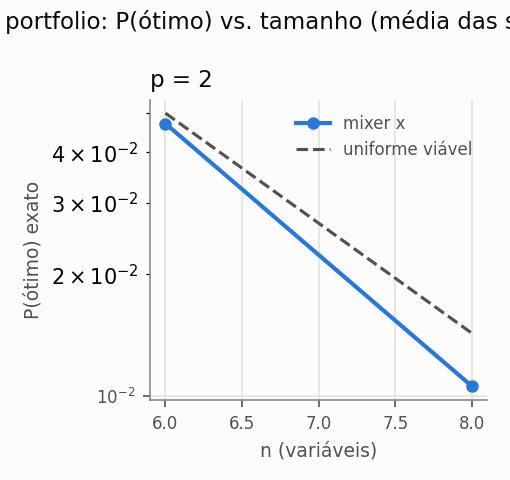
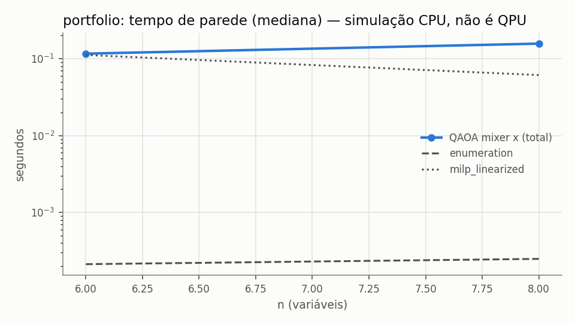

# e1c_penalty — resumo gerado de `records.jsonl`

- run_id: `20261015T192429Z-2b154f` · kind: `algorithm_benchmark` · track: `algorithm_benchmark`
- commit: `fc936b306ae185aba003a6ff2933b24877c54ceb` (working tree suja: False)
- config_hash: `eda80fcab9df239f` · registros: 870 · tempo de parede: 112.5s · modo quick: False
- Python 3.10.8 · qiskit 1.4.6 · qiskit-aer 0.17.2 · GPU: host_has_nvidia_gpu_but_qiskit_aer_build_is_cpu_only
- Toda execução quântica aqui é SIMULAÇÃO em CPU (`is_real_hardware=false`), salvo indicação explícita.
### Baselines clássicos (mesmo objetivo)

| domain | n | algorithm | runs | taxa_ótimo | gap_abs_médio | P(ótimo)_amostra | tempo_s_médio |
|---|---|---|---|---|---|---|---|
| portfolio | 6 | enumeration | 3 | 1.0000 | 0.0000 | — | 2.08e-04 |
| portfolio | 6 | lp_relaxation_mccormick | 3 | — | — | — | 0.0636 |
| portfolio | 6 | milp_linearized | 3 | 1.0000 | 0.0000 | — | 0.1225 |
| portfolio | 6 | random_feasible_sampling | 3 | 1.0000 | 0.0000 | 0.0488 | 0.0200 |
| portfolio | 6 | simulated_annealing | 3 | 1.0000 | 0.0000 | — | 0.1245 |
| portfolio | 8 | enumeration | 3 | 1.0000 | 0.0000 | — | 2.84e-04 |
| portfolio | 8 | lp_relaxation_mccormick | 3 | — | — | — | 0.0361 |
| portfolio | 8 | milp_linearized | 3 | 1.0000 | -5.78e-19 | — | 0.0743 |
| portfolio | 8 | random_feasible_sampling | 3 | 1.0000 | 0.0000 | 0.0137 | 0.0166 |
| portfolio | 8 | simulated_annealing | 3 | 1.0000 | -5.78e-19 | — | 0.0956 |

### QAOA (simulação ideal exata + amostragem finita)

`÷ uniforme viável` = P(ótimo) exato dividido pela probabilidade de sortear um ótimo uniformemente entre as C(n,k) seleções viáveis (baseline aleatório). Valores ≤ 1 significam que o circuito não concentrou probabilidade no ótimo. `runs` = execuções; `indep.` = otimizações distintas (pseudo-réplicas removidas das métricas exatas e do IC). `melhor amostra ótima` = fração de execuções cuja melhor amostra viável é ótima — compare com `random_feasible_sampling`, que usa o MESMO número de amostras.

| domain | n | algorithm | p | init_strategy | penalty_factor | runs | indep. | P(ótimo) exato [IC95] | ÷ uniforme viável | P(viável) exato | melhor amostra ótima | avaliações | tempo_total_s |
|---|---|---|---|---|---|---|---|---|---|---|---|---|---|
| portfolio | 6 | qaoa_x | 2 | linear_ramp | 0.0200 | 30 | 3 | 0.1502 [0.0708, 0.2383] | 3.0037 | 0.4848 | 1.0000 | 163.3333 | 0.1192 |
| portfolio | 6 | qaoa_x | 2 | linear_ramp | 0.0500 | 30 | 3 | 0.1430 [0.0805, 0.2418] | 2.8595 | 0.5981 | 1.0000 | 164 | 0.1104 |
| portfolio | 6 | qaoa_x | 2 | linear_ramp | 0.1000 | 30 | 3 | 0.1085 [0.0435, 0.2339] | 2.1698 | 0.6649 | 1.0000 | 200 | 0.1299 |
| portfolio | 6 | qaoa_x | 2 | linear_ramp | 0.2500 | 30 | 3 | 0.0392 [0.0318, 0.0451] | 0.7836 | 0.6434 | 1.0000 | 140 | 0.1016 |
| portfolio | 6 | qaoa_x | 2 | linear_ramp | 0.5000 | 30 | 3 | 0.0424 [0.0359, 0.0487] | 0.8473 | 0.8228 | 1.0000 | 200 | 0.1564 |
| portfolio | 6 | qaoa_x | 2 | linear_ramp | 1.0000 | 30 | 3 | 0.0447 [0.0351, 0.0499] | 0.8946 | 0.9104 | 1.0000 | 200 | 0.1580 |
| portfolio | 6 | qaoa_x | 2 | linear_ramp | 2.0000 | 30 | 3 | 0.0410 [0.0362, 0.0498] | 0.8202 | 0.8274 | 1.0000 | 200 | 0.1386 |
| portfolio | 6 | qaoa_x | 2 | random | 0.0200 | 30 | 30 | 0.0653 [0.0404, 0.0922] | 1.3058 | 0.3746 | 0.9333 | 138.0333 | 0.0986 |
| portfolio | 6 | qaoa_x | 2 | random | 0.0500 | 30 | 30 | 0.0434 [0.0270, 0.0642] | 0.8683 | 0.4054 | 1.0000 | 138.1667 | 0.0942 |
| portfolio | 6 | qaoa_x | 2 | random | 0.1000 | 30 | 30 | 0.0349 [0.0220, 0.0522] | 0.6979 | 0.4316 | 0.8667 | 128.6667 | 0.0928 |
| portfolio | 6 | qaoa_x | 2 | random | 0.2500 | 30 | 30 | 0.0393 [0.0269, 0.0528] | 0.7860 | 0.5208 | 0.9667 | 134.4333 | 0.0965 |
| portfolio | 6 | qaoa_x | 2 | random | 0.5000 | 30 | 30 | 0.0538 [0.0365, 0.0746] | 1.0766 | 0.6885 | 1.0000 | 173.4333 | 0.1429 |
| portfolio | 6 | qaoa_x | 2 | random | 1.0000 | 30 | 30 | 0.0536 [0.0452, 0.0629] | 1.0716 | 0.7539 | 1.0000 | 165.2667 | 0.1245 |
| portfolio | 6 | qaoa_x | 2 | random | 2.0000 | 30 | 30 | 0.0396 [0.0360, 0.0435] | 0.7917 | 0.7971 | 1.0000 | 178.5667 | 0.1213 |
| portfolio | 8 | qaoa_x | 2 | linear_ramp | 0.0200 | 30 | 3 | 0.0253 [0.0146, 0.0425] | 1.7708 | 0.4785 | 1.0000 | 158.3333 | 0.1356 |
| portfolio | 8 | qaoa_x | 2 | linear_ramp | 0.0500 | 30 | 3 | 0.0130 [0.0093, 0.0152] | 0.9128 | 0.5619 | 1.0000 | 200 | 0.1702 |
| portfolio | 8 | qaoa_x | 2 | linear_ramp | 0.1000 | 30 | 3 | 0.0116 [0.0064, 0.0172] | 0.8110 | 0.6426 | 0.9667 | 168.6667 | 0.1461 |
| portfolio | 8 | qaoa_x | 2 | linear_ramp | 0.2500 | 30 | 3 | 0.0105 [0.0063, 0.0166] | 0.7347 | 0.5822 | 1.0000 | 200 | 0.1703 |
| portfolio | 8 | qaoa_x | 2 | linear_ramp | 0.5000 | 30 | 3 | 0.0129 [0.0121, 0.0139] | 0.9003 | 0.8077 | 1.0000 | 126 | 0.1118 |
| portfolio | 8 | qaoa_x | 2 | linear_ramp | 1.0000 | 30 | 3 | 0.0135 [0.0132, 0.0136] | 0.9448 | 0.8232 | 1.0000 | 113 | 0.0968 |
| portfolio | 8 | qaoa_x | 2 | linear_ramp | 2.0000 | 30 | 3 | 0.0127 [0.0126, 0.0128] | 0.8864 | 0.8289 | 1.0000 | 121.3333 | 0.1036 |
| portfolio | 8 | qaoa_x | 2 | random | 0.0200 | 30 | 30 | 0.0117 [0.0089, 0.0146] | 0.8202 | 0.3622 | 0.9000 | 158.7667 | 0.1387 |
| portfolio | 8 | qaoa_x | 2 | random | 0.0500 | 30 | 30 | 0.0099 [0.0075, 0.0125] | 0.6899 | 0.3695 | 0.9333 | 150.3333 | 0.1320 |
| portfolio | 8 | qaoa_x | 2 | random | 0.1000 | 30 | 30 | 0.0090 [0.0052, 0.0139] | 0.6313 | 0.3553 | 0.8000 | 136.8333 | 0.1205 |
| portfolio | 8 | qaoa_x | 2 | random | 0.2500 | 30 | 30 | 0.0114 [0.0090, 0.0139] | 0.7946 | 0.4620 | 1.0000 | 165.6667 | 0.1454 |
| portfolio | 8 | qaoa_x | 2 | random | 0.5000 | 30 | 30 | 0.0117 [0.0097, 0.0137] | 0.8169 | 0.6205 | 0.9667 | 181.5000 | 0.1515 |
| portfolio | 8 | qaoa_x | 2 | random | 1.0000 | 30 | 30 | 0.0101 [0.0087, 0.0115] | 0.7044 | 0.6747 | 1.0000 | 175.1333 | 0.1431 |
| portfolio | 8 | qaoa_x | 2 | random | 2.0000 | 30 | 30 | 0.0103 [0.0092, 0.0115] | 0.7213 | 0.6795 | 0.9667 | 175.3000 | 0.1487 |

### Recursos (QAOA)

| domain | n | algorithm | runs | statevector_teórico_MB | pico_tracemalloc_MB | tempo_otimização_s | 2Q_lógicas_total |
|---|---|---|---|---|---|---|---|
| portfolio | 6 | qaoa_x | 420 | 9.77e-04 | 0.1122 | 0.1117 | 30 |
| portfolio | 8 | qaoa_x | 420 | 0.0039 | 0.2870 | 0.1176 | 56 |

