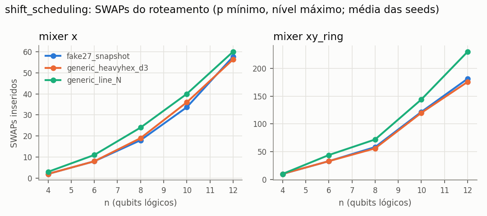

# e2_hardware_aware — resumo gerado de `records.jsonl`

- run_id: `20261015T213803Z-1830f6` · kind: `transpilation` · track: `hardware`
- commit: `2b5c85f7ea3d7142eb7ed6b7660e1482b2fcd450` (working tree suja: False)
- config_hash: `f6f28f4430c00601` · registros: 960 · tempo de parede: 126.7s · modo quick: False
- Python 3.10.8 · qiskit 1.4.6 · qiskit-aer 0.17.2 · GPU: host_has_nvidia_gpu_but_qiskit_aer_build_is_cpu_only
- Toda execução quântica aqui é SIMULAÇÃO em CPU (`is_real_hardware=false`), salvo indicação explícita.
| domain | mixer | p | backend_family | optimization_level | n | runs | 2Q_lógicas | 2Q_físicas | SWAPs | depth_lógica | depth_física | depth_2Q_física | tempo_transpile_s | Target_ok |
|---|---|---|---|---|---|---|---|---|---|---|---|---|---|---|
| portfolio | x | 1 | fake27_snapshot | 1 | 4 | 3 | 6 | 18.0000 | 2.0000 | 9.0000 | 39.6667 | 18.0000 | 0.0073 | sim |
| portfolio | x | 1 | fake27_snapshot | 1 | 6 | 3 | 15 | 53.3333 | 8.0000 | 13.0000 | 73.6667 | 40.0000 | 0.0103 | sim |
| portfolio | x | 1 | fake27_snapshot | 1 | 8 | 3 | 28 | 116.6667 | 20.6667 | 17.0000 | 118.3333 | 79.3333 | 0.0121 | sim |
| portfolio | x | 1 | fake27_snapshot | 1 | 10 | 3 | 45 | 196.3333 | 37.6667 | 21.0000 | 172.0000 | 117.0000 | 0.0176 | sim |
| portfolio | x | 1 | fake27_snapshot | 1 | 12 | 3 | 66 | 310.6667 | 62.0000 | 25.0000 | 212.6667 | 157.6667 | 0.0233 | sim |
| portfolio | x | 1 | fake27_snapshot | 3 | 4 | 3 | 6 | 17.3333 | 2.0000 | 9.0000 | 39.3333 | 17.3333 | 0.0129 | sim |
| portfolio | x | 1 | fake27_snapshot | 3 | 6 | 3 | 15 | 47.3333 | 8.0000 | 13.0000 | 69.3333 | 37.6667 | 0.0215 | sim |
| portfolio | x | 1 | fake27_snapshot | 3 | 8 | 3 | 28 | 87.3333 | 18.0000 | 17.0000 | 108.3333 | 57.3333 | 0.0509 | sim |
| portfolio | x | 1 | fake27_snapshot | 3 | 10 | 3 | 45 | 166.3333 | 33.6667 | 21.0000 | 155.6667 | 107.0000 | 0.0754 | sim |
| portfolio | x | 1 | fake27_snapshot | 3 | 12 | 3 | 66 | 265.0000 | 57.6667 | 25.0000 | 193.3333 | 133.3333 | 0.0802 | sim |
| portfolio | x | 1 | generic_all_to_all_N | 1 | 4 | 3 | 6 | 12.0000 | 0.0000 | 9.0000 | 24.0000 | 10.0000 | 0.0039 | sim |
| portfolio | x | 1 | generic_all_to_all_N | 1 | 6 | 3 | 15 | 30.0000 | 0.0000 | 13.0000 | 36.0000 | 18.0000 | 0.0041 | sim |
| portfolio | x | 1 | generic_all_to_all_N | 1 | 8 | 3 | 28 | 56.0000 | 0.0000 | 17.0000 | 48.0000 | 26.0000 | 0.0068 | sim |
| portfolio | x | 1 | generic_all_to_all_N | 1 | 10 | 3 | 45 | 90.0000 | 0.0000 | 21.0000 | 60.0000 | 34.0000 | 0.0071 | sim |
| portfolio | x | 1 | generic_all_to_all_N | 1 | 12 | 3 | 66 | 132.0000 | 0.0000 | 25.0000 | 72.0000 | 42.0000 | 0.0098 | sim |
| portfolio | x | 1 | generic_all_to_all_N | 3 | 4 | 3 | 6 | 12.0000 | 0.0000 | 9.0000 | 24.0000 | 10.0000 | 0.0066 | sim |
| portfolio | x | 1 | generic_all_to_all_N | 3 | 6 | 3 | 15 | 30.0000 | 0.0000 | 13.0000 | 36.0000 | 18.0000 | 0.0122 | sim |
| portfolio | x | 1 | generic_all_to_all_N | 3 | 8 | 3 | 28 | 56.0000 | 0.0000 | 17.0000 | 51.0000 | 26.0000 | 0.0161 | sim |
| portfolio | x | 1 | generic_all_to_all_N | 3 | 10 | 3 | 45 | 90.0000 | 0.0000 | 21.0000 | 60.0000 | 34.0000 | 0.0164 | sim |
| portfolio | x | 1 | generic_all_to_all_N | 3 | 12 | 3 | 66 | 132.0000 | 0.0000 | 25.0000 | 72.0000 | 42.0000 | 0.0279 | sim |
| portfolio | x | 1 | generic_heavyhex_d3 | 1 | 4 | 3 | 6 | 20.0000 | 2.6667 | 9.0000 | 39.6667 | 18.6667 | 0.0081 | sim |
| portfolio | x | 1 | generic_heavyhex_d3 | 1 | 6 | 3 | 15 | 54.0000 | 8.6667 | 13.0000 | 72.3333 | 44.6667 | 0.0087 | sim |
| portfolio | x | 1 | generic_heavyhex_d3 | 1 | 8 | 3 | 28 | 107.3333 | 20.0000 | 17.0000 | 109.0000 | 71.6667 | 0.0141 | sim |
| portfolio | x | 1 | generic_heavyhex_d3 | 1 | 10 | 3 | 45 | 193.3333 | 37.3333 | 21.0000 | 162.0000 | 119.3333 | 0.0156 | sim |
| portfolio | x | 1 | generic_heavyhex_d3 | 1 | 12 | 3 | 66 | 280.0000 | 57.3333 | 25.0000 | 198.3333 | 148.3333 | 0.0202 | sim |
| portfolio | x | 1 | generic_heavyhex_d3 | 3 | 4 | 3 | 6 | 18.0000 | 2.0000 | 9.0000 | 38.6667 | 18.0000 | 0.0118 | sim |
| portfolio | x | 1 | generic_heavyhex_d3 | 3 | 6 | 3 | 15 | 47.3333 | 8.0000 | 13.0000 | 68.0000 | 38.6667 | 0.0201 | sim |
| portfolio | x | 1 | generic_heavyhex_d3 | 3 | 8 | 3 | 28 | 99.0000 | 19.0000 | 17.0000 | 127.0000 | 71.6667 | 0.0324 | sim |
| portfolio | x | 1 | generic_heavyhex_d3 | 3 | 10 | 3 | 45 | 177.3333 | 36.0000 | 21.0000 | 171.0000 | 107.3333 | 0.0603 | sim |
| portfolio | x | 1 | generic_heavyhex_d3 | 3 | 12 | 3 | 66 | 259.0000 | 56.3333 | 25.0000 | 213.6667 | 139.6667 | 0.0832 | sim |
| portfolio | x | 1 | generic_line_N | 1 | 4 | 3 | 6 | 20.3333 | 3.0000 | 9.0000 | 37.3333 | 18.3333 | 0.0069 | sim |
| portfolio | x | 1 | generic_line_N | 1 | 6 | 3 | 15 | 58.3333 | 11.0000 | 13.0000 | 69.6667 | 40.6667 | 0.0082 | sim |
| portfolio | x | 1 | generic_line_N | 1 | 8 | 3 | 28 | 126.6667 | 25.3333 | 17.0000 | 107.3333 | 75.6667 | 0.0105 | sim |
| portfolio | x | 1 | generic_line_N | 1 | 10 | 3 | 45 | 197.3333 | 42.0000 | 21.0000 | 140.6667 | 99.0000 | 0.0141 | sim |
| portfolio | x | 1 | generic_line_N | 1 | 12 | 3 | 66 | 295.3333 | 64.6667 | 25.0000 | 175.0000 | 131.3333 | 0.0240 | sim |
| portfolio | x | 1 | generic_line_N | 3 | 4 | 3 | 6 | 18.3333 | 3.0000 | 9.0000 | 36.6667 | 16.3333 | 0.0119 | sim |
| portfolio | x | 1 | generic_line_N | 3 | 6 | 3 | 15 | 50.3333 | 11.0000 | 13.0000 | 67.6667 | 36.0000 | 0.0180 | sim |
| portfolio | x | 1 | generic_line_N | 3 | 8 | 3 | 28 | 100.6667 | 24.0000 | 17.0000 | 96.3333 | 59.6667 | 0.0397 | sim |
| portfolio | x | 1 | generic_line_N | 3 | 10 | 3 | 45 | 166.6667 | 40.0000 | 21.0000 | 123.0000 | 83.0000 | 0.0557 | sim |
| portfolio | x | 1 | generic_line_N | 3 | 12 | 3 | 66 | 261.3333 | 60.0000 | 25.0000 | 159.6667 | 112.0000 | 0.1015 | sim |
| portfolio | x | 2 | fake27_snapshot | 1 | 4 | 3 | 12 | 34.0000 | 3.3333 | 15.0000 | 70.0000 | 34.0000 | 0.0105 | sim |
| portfolio | x | 2 | fake27_snapshot | 1 | 6 | 3 | 30 | 119.3333 | 20.6667 | 21.0000 | 143.6667 | 92.0000 | 0.0131 | sim |
| portfolio | x | 2 | fake27_snapshot | 1 | 8 | 3 | 56 | 258.6667 | 50.6667 | 27.0000 | 215.6667 | 148.0000 | 0.0197 | sim |
| portfolio | x | 2 | fake27_snapshot | 1 | 10 | 3 | 90 | 439.0000 | 91.0000 | 33.0000 | 312.0000 | 229.6667 | 0.0302 | sim |
| portfolio | x | 2 | fake27_snapshot | 1 | 12 | 3 | 132 | 656.0000 | 140.6667 | 39.0000 | 402.0000 | 301.6667 | 0.0292 | sim |
| portfolio | x | 2 | fake27_snapshot | 3 | 4 | 3 | 12 | 33.0000 | 3.0000 | 15.0000 | 68.0000 | 33.0000 | 0.0184 | sim |
| portfolio | x | 2 | fake27_snapshot | 3 | 6 | 3 | 30 | 109.6667 | 20.3333 | 21.0000 | 139.6667 | 84.3333 | 0.0403 | sim |
| portfolio | x | 2 | fake27_snapshot | 3 | 8 | 3 | 56 | 245.3333 | 45.3333 | 27.0000 | 215.0000 | 152.3333 | 0.0594 | sim |
| portfolio | x | 2 | fake27_snapshot | 3 | 10 | 3 | 90 | 402.6667 | 85.3333 | 33.0000 | 297.6667 | 199.6667 | 0.1063 | sim |
| portfolio | x | 2 | fake27_snapshot | 3 | 12 | 3 | 132 | 604.0000 | 131.3333 | 39.0000 | 408.0000 | 286.3333 | 0.1442 | sim |
| portfolio | x | 2 | generic_all_to_all_N | 1 | 4 | 3 | 12 | 24.0000 | 0.0000 | 15.0000 | 41.0000 | 18.0000 | 0.0042 | sim |
| portfolio | x | 2 | generic_all_to_all_N | 1 | 6 | 3 | 30 | 60.0000 | 0.0000 | 21.0000 | 59.0000 | 30.0000 | 0.0055 | sim |
| portfolio | x | 2 | generic_all_to_all_N | 1 | 8 | 3 | 56 | 112.0000 | 0.0000 | 27.0000 | 77.0000 | 42.0000 | 0.0066 | sim |
| portfolio | x | 2 | generic_all_to_all_N | 1 | 10 | 3 | 90 | 180.0000 | 0.0000 | 33.0000 | 95.0000 | 54.0000 | 0.0090 | sim |
| portfolio | x | 2 | generic_all_to_all_N | 1 | 12 | 3 | 132 | 264.0000 | 0.0000 | 39.0000 | 113.0000 | 66.0000 | 0.0100 | sim |
| portfolio | x | 2 | generic_all_to_all_N | 3 | 4 | 3 | 12 | 24.0000 | 0.0000 | 15.0000 | 41.0000 | 18.0000 | 0.0090 | sim |
| portfolio | x | 2 | generic_all_to_all_N | 3 | 6 | 3 | 30 | 60.0000 | 0.0000 | 21.0000 | 59.0000 | 30.0000 | 0.0166 | sim |
| portfolio | x | 2 | generic_all_to_all_N | 3 | 8 | 3 | 56 | 112.0000 | 0.0000 | 27.0000 | 77.0000 | 42.0000 | 0.0200 | sim |
| portfolio | x | 2 | generic_all_to_all_N | 3 | 10 | 3 | 90 | 180.0000 | 0.0000 | 33.0000 | 95.0000 | 54.0000 | 0.0271 | sim |
| portfolio | x | 2 | generic_all_to_all_N | 3 | 12 | 3 | 132 | 264.0000 | 0.0000 | 39.0000 | 113.0000 | 66.0000 | 0.0344 | sim |
| portfolio | x | 2 | generic_heavyhex_d3 | 1 | 4 | 3 | 12 | 42.3333 | 6.3333 | 15.0000 | 76.3333 | 38.6667 | 0.0084 | sim |
| portfolio | x | 2 | generic_heavyhex_d3 | 1 | 6 | 3 | 30 | 123.0000 | 21.0000 | 21.0000 | 148.3333 | 94.6667 | 0.0113 | sim |
| portfolio | x | 2 | generic_heavyhex_d3 | 1 | 8 | 3 | 56 | 255.6667 | 50.3333 | 27.0000 | 215.3333 | 148.3333 | 0.0202 | sim |
| portfolio | x | 2 | generic_heavyhex_d3 | 1 | 10 | 3 | 90 | 439.6667 | 90.3333 | 33.0000 | 288.6667 | 215.3333 | 0.0243 | sim |
| portfolio | x | 2 | generic_heavyhex_d3 | 1 | 12 | 3 | 132 | 683.6667 | 147.0000 | 39.0000 | 428.3333 | 328.6667 | 0.0349 | sim |
| portfolio | x | 2 | generic_heavyhex_d3 | 3 | 4 | 3 | 12 | 33.0000 | 3.0000 | 15.0000 | 68.0000 | 33.0000 | 0.0182 | sim |
| portfolio | x | 2 | generic_heavyhex_d3 | 3 | 6 | 3 | 30 | 110.3333 | 20.3333 | 21.0000 | 138.6667 | 85.0000 | 0.0320 | sim |
| portfolio | x | 2 | generic_heavyhex_d3 | 3 | 8 | 3 | 56 | 229.3333 | 44.0000 | 27.0000 | 220.6667 | 138.6667 | 0.0748 | sim |
| portfolio | x | 2 | generic_heavyhex_d3 | 3 | 10 | 3 | 90 | 412.3333 | 87.0000 | 33.0000 | 314.6667 | 221.3333 | 0.0985 | sim |
| portfolio | x | 2 | generic_heavyhex_d3 | 3 | 12 | 3 | 132 | 602.3333 | 133.6667 | 39.0000 | 393.3333 | 271.0000 | 0.1267 | sim |
| portfolio | x | 2 | generic_line_N | 1 | 4 | 3 | 12 | 47.3333 | 8.0000 | 15.0000 | 78.6667 | 41.3333 | 0.0059 | sim |
| portfolio | x | 2 | generic_line_N | 1 | 6 | 3 | 30 | 132.0000 | 25.3333 | 21.0000 | 141.3333 | 86.6667 | 0.0131 | sim |
| portfolio | x | 2 | generic_line_N | 1 | 8 | 3 | 56 | 273.3333 | 54.6667 | 27.0000 | 206.6667 | 138.6667 | 0.0165 | sim |
| portfolio | x | 2 | generic_line_N | 1 | 10 | 3 | 90 | 433.6667 | 85.0000 | 33.0000 | 254.3333 | 171.3333 | 0.0196 | sim |
| portfolio | x | 2 | generic_line_N | 1 | 12 | 3 | 132 | 594.6667 | 123.3333 | 39.0000 | 309.6667 | 202.3333 | 0.0310 | sim |
| portfolio | x | 2 | generic_line_N | 3 | 4 | 3 | 12 | 40.6667 | 8.0000 | 15.0000 | 71.3333 | 34.6667 | 0.0143 | sim |
| portfolio | x | 2 | generic_line_N | 3 | 6 | 3 | 30 | 117.6667 | 25.0000 | 21.0000 | 129.6667 | 74.3333 | 0.0340 | sim |
| portfolio | x | 2 | generic_line_N | 3 | 8 | 3 | 56 | 262.6667 | 54.0000 | 27.0000 | 205.6667 | 132.0000 | 0.0645 | sim |
| portfolio | x | 2 | generic_line_N | 3 | 10 | 3 | 90 | 377.3333 | 81.3333 | 33.0000 | 230.3333 | 147.6667 | 0.0963 | sim |
| portfolio | x | 2 | generic_line_N | 3 | 12 | 3 | 132 | 547.3333 | 122.0000 | 39.0000 | 325.3333 | 193.0000 | 0.1210 | sim |
| portfolio | xy_ring | 1 | fake27_snapshot | 1 | 4 | 3 | 27 | 92.0000 | 11.3333 | 30.0000 | 210.3333 | 92.0000 | 0.0183 | sim |
| portfolio | xy_ring | 1 | fake27_snapshot | 1 | 6 | 3 | 56 | 258.0000 | 42.0000 | 54.0000 | 488.0000 | 227.3333 | 0.0286 | sim |
| portfolio | xy_ring | 1 | fake27_snapshot | 1 | 8 | 3 | 95 | 465.6667 | 77.6667 | 76.0000 | 821.0000 | 377.6667 | 0.0649 | sim |
| portfolio | xy_ring | 1 | fake27_snapshot | 1 | 10 | 3 | 144 | 788.6667 | 144.0000 | 98.0000 | 1084.6667 | 529.6667 | 0.0783 | sim |
| portfolio | xy_ring | 1 | fake27_snapshot | 1 | 12 | 3 | 203 | 1149.3333 | 206.6667 | 120.0000 | 1493.0000 | 726.0000 | 0.0997 | sim |
| portfolio | xy_ring | 1 | fake27_snapshot | 3 | 4 | 3 | 27 | 67.0000 | 11.0000 | 30.0000 | 168.0000 | 67.0000 | 0.0347 | sim |
| portfolio | xy_ring | 1 | fake27_snapshot | 3 | 6 | 3 | 56 | 214.0000 | 42.0000 | 54.0000 | 432.6667 | 188.0000 | 0.0796 | sim |
| portfolio | xy_ring | 1 | fake27_snapshot | 3 | 8 | 3 | 95 | 381.0000 | 74.6667 | 76.0000 | 769.6667 | 321.6667 | 0.1397 | sim |
| portfolio | xy_ring | 1 | fake27_snapshot | 3 | 10 | 3 | 144 | 637.0000 | 137.6667 | 98.0000 | 1058.3333 | 452.6667 | 0.2224 | sim |
| portfolio | xy_ring | 1 | fake27_snapshot | 3 | 12 | 3 | 203 | 958.6667 | 202.6667 | 120.0000 | 1445.0000 | 624.0000 | 0.3334 | sim |
| portfolio | xy_ring | 1 | generic_all_to_all_N | 1 | 4 | 3 | 27 | 60.0000 | 0.0000 | 30.0000 | 160.0000 | 56.0000 | 0.0104 | sim |
| portfolio | xy_ring | 1 | generic_all_to_all_N | 1 | 6 | 3 | 56 | 144.0000 | 0.0000 | 54.0000 | 334.0000 | 117.0000 | 0.0192 | sim |
| portfolio | xy_ring | 1 | generic_all_to_all_N | 1 | 8 | 3 | 95 | 266.0000 | 0.0000 | 76.0000 | 560.0000 | 195.0000 | 0.0290 | sim |
| portfolio | xy_ring | 1 | generic_all_to_all_N | 1 | 10 | 3 | 144 | 426.0000 | 0.0000 | 98.0000 | 750.0000 | 261.0000 | 0.0481 | sim |
| portfolio | xy_ring | 1 | generic_all_to_all_N | 1 | 12 | 3 | 203 | 624.0000 | 0.0000 | 120.0000 | 940.0000 | 327.0000 | 0.1107 | sim |
| portfolio | xy_ring | 1 | generic_all_to_all_N | 3 | 4 | 3 | 27 | 43.0000 | 0.0000 | 30.0000 | 121.0000 | 39.0000 | 0.0196 | sim |
| portfolio | xy_ring | 1 | generic_all_to_all_N | 3 | 6 | 3 | 56 | 114.0000 | 0.0000 | 54.0000 | 275.0000 | 90.0000 | 0.0531 | sim |
| portfolio | xy_ring | 1 | generic_all_to_all_N | 3 | 8 | 3 | 95 | 220.0000 | 0.0000 | 76.0000 | 478.0000 | 162.0000 | 0.0754 | sim |
| portfolio | xy_ring | 1 | generic_all_to_all_N | 3 | 10 | 3 | 144 | 361.0000 | 0.0000 | 98.0000 | 649.0000 | 220.0000 | 0.1412 | sim |
| portfolio | xy_ring | 1 | generic_all_to_all_N | 3 | 12 | 3 | 203 | 537.0000 | 0.0000 | 120.0000 | 822.0000 | 278.0000 | 0.1794 | sim |
| portfolio | xy_ring | 1 | generic_heavyhex_d3 | 1 | 4 | 3 | 27 | 97.3333 | 14.0000 | 30.0000 | 210.3333 | 94.0000 | 0.0171 | sim |
| portfolio | xy_ring | 1 | generic_heavyhex_d3 | 1 | 6 | 3 | 56 | 258.6667 | 42.6667 | 54.0000 | 494.6667 | 229.3333 | 0.0287 | sim |
| portfolio | xy_ring | 1 | generic_heavyhex_d3 | 1 | 8 | 3 | 95 | 458.0000 | 77.3333 | 76.0000 | 809.3333 | 371.3333 | 0.0483 | sim |
| portfolio | xy_ring | 1 | generic_heavyhex_d3 | 1 | 10 | 3 | 144 | 788.0000 | 140.0000 | 98.0000 | 1196.0000 | 572.0000 | 0.0903 | sim |
| portfolio | xy_ring | 1 | generic_heavyhex_d3 | 1 | 12 | 3 | 203 | 1146.3333 | 207.0000 | 120.0000 | 1460.3333 | 713.0000 | 0.1002 | sim |
| portfolio | xy_ring | 1 | generic_heavyhex_d3 | 3 | 4 | 3 | 27 | 70.3333 | 11.3333 | 30.0000 | 172.3333 | 70.3333 | 0.0334 | sim |
| portfolio | xy_ring | 1 | generic_heavyhex_d3 | 3 | 6 | 3 | 56 | 214.0000 | 42.0000 | 54.0000 | 436.6667 | 189.6667 | 0.1029 | sim |
| portfolio | xy_ring | 1 | generic_heavyhex_d3 | 3 | 8 | 3 | 95 | 380.3333 | 74.3333 | 76.0000 | 778.6667 | 321.6667 | 0.1264 | sim |
| portfolio | xy_ring | 1 | generic_heavyhex_d3 | 3 | 10 | 3 | 144 | 653.3333 | 140.6667 | 98.0000 | 1168.6667 | 494.3333 | 0.2390 | sim |
| portfolio | xy_ring | 1 | generic_heavyhex_d3 | 3 | 12 | 3 | 203 | 952.0000 | 195.0000 | 120.0000 | 1392.0000 | 592.3333 | 0.3432 | sim |
| portfolio | xy_ring | 1 | generic_line_N | 1 | 4 | 3 | 27 | 99.6667 | 15.0000 | 30.0000 | 211.6667 | 94.6667 | 0.0153 | sim |
| portfolio | xy_ring | 1 | generic_line_N | 1 | 6 | 3 | 56 | 288.3333 | 51.0000 | 54.0000 | 491.3333 | 240.3333 | 0.0274 | sim |
| portfolio | xy_ring | 1 | generic_line_N | 1 | 8 | 3 | 95 | 502.6667 | 96.0000 | 76.0000 | 754.3333 | 359.0000 | 0.0464 | sim |
| portfolio | xy_ring | 1 | generic_line_N | 1 | 10 | 3 | 144 | 810.6667 | 158.0000 | 98.0000 | 1033.6667 | 494.6667 | 0.0844 | sim |
| portfolio | xy_ring | 1 | generic_line_N | 1 | 12 | 3 | 203 | 1202.6667 | 236.0000 | 120.0000 | 1376.6667 | 669.0000 | 0.0909 | sim |
| portfolio | xy_ring | 1 | generic_line_N | 3 | 4 | 3 | 27 | 74.0000 | 15.0000 | 30.0000 | 182.0000 | 69.0000 | 0.0390 | sim |
| portfolio | xy_ring | 1 | generic_line_N | 3 | 6 | 3 | 56 | 247.0000 | 51.0000 | 54.0000 | 441.0000 | 205.0000 | 0.0816 | sim |
| portfolio | xy_ring | 1 | generic_line_N | 3 | 8 | 3 | 95 | 401.3333 | 96.0000 | 76.0000 | 711.0000 | 294.3333 | 0.1555 | sim |
| portfolio | xy_ring | 1 | generic_line_N | 3 | 10 | 3 | 144 | 647.0000 | 155.3333 | 98.0000 | 1016.3333 | 436.3333 | 0.2113 | sim |
| portfolio | xy_ring | 1 | generic_line_N | 3 | 12 | 3 | 203 | 946.6667 | 234.0000 | 120.0000 | 1214.6667 | 524.3333 | 0.3620 | sim |
| portfolio | xy_ring | 2 | fake27_snapshot | 1 | 4 | 3 | 41 | 131.3333 | 15.3333 | 43.0000 | 296.3333 | 131.3333 | 0.0219 | sim |
| portfolio | xy_ring | 2 | fake27_snapshot | 1 | 6 | 3 | 83 | 361.6667 | 59.6667 | 73.0000 | 631.6667 | 312.0000 | 0.0315 | sim |
| portfolio | xy_ring | 2 | fake27_snapshot | 1 | 8 | 3 | 139 | 649.0000 | 117.0000 | 101.0000 | 1007.6667 | 485.0000 | 0.0606 | sim |
| portfolio | xy_ring | 2 | fake27_snapshot | 1 | 10 | 3 | 209 | 1083.3333 | 201.3333 | 129.0000 | 1441.0000 | 743.6667 | 0.0813 | sim |
| portfolio | xy_ring | 2 | fake27_snapshot | 1 | 12 | 3 | 293 | 1588.6667 | 300.6667 | 157.0000 | 1810.0000 | 941.0000 | 0.1172 | sim |
| portfolio | xy_ring | 2 | fake27_snapshot | 3 | 4 | 3 | 41 | 97.0000 | 14.3333 | 43.0000 | 235.6667 | 97.0000 | 0.0627 | sim |
| portfolio | xy_ring | 2 | fake27_snapshot | 3 | 6 | 3 | 83 | 302.6667 | 59.3333 | 73.0000 | 547.0000 | 259.6667 | 0.1139 | sim |
| portfolio | xy_ring | 2 | fake27_snapshot | 3 | 8 | 3 | 139 | 539.6667 | 107.6667 | 101.0000 | 955.0000 | 423.0000 | 0.2031 | sim |
| portfolio | xy_ring | 2 | fake27_snapshot | 3 | 10 | 3 | 209 | 890.3333 | 196.6667 | 129.0000 | 1290.3333 | 601.6667 | 0.2997 | sim |
| portfolio | xy_ring | 2 | fake27_snapshot | 3 | 12 | 3 | 293 | 1319.6667 | 279.6667 | 157.0000 | 1707.6667 | 777.3333 | 0.4260 | sim |
| portfolio | xy_ring | 2 | generic_all_to_all_N | 1 | 4 | 3 | 41 | 88.0000 | 0.0000 | 43.0000 | 217.0000 | 80.0000 | 0.0154 | sim |
| portfolio | xy_ring | 2 | generic_all_to_all_N | 1 | 6 | 3 | 83 | 198.0000 | 0.0000 | 73.0000 | 417.0000 | 153.0000 | 0.0242 | sim |
| portfolio | xy_ring | 2 | generic_all_to_all_N | 1 | 8 | 3 | 139 | 354.0000 | 0.0000 | 101.0000 | 669.0000 | 243.0000 | 0.0372 | sim |
| portfolio | xy_ring | 2 | generic_all_to_all_N | 1 | 10 | 3 | 209 | 556.0000 | 0.0000 | 129.0000 | 885.0000 | 321.0000 | 0.0474 | sim |
| portfolio | xy_ring | 2 | generic_all_to_all_N | 1 | 12 | 3 | 293 | 804.0000 | 0.0000 | 157.0000 | 1101.0000 | 399.0000 | 0.0711 | sim |
| portfolio | xy_ring | 2 | generic_all_to_all_N | 3 | 4 | 3 | 41 | 63.0000 | 0.0000 | 43.0000 | 165.0000 | 55.0000 | 0.0242 | sim |
| portfolio | xy_ring | 2 | generic_all_to_all_N | 3 | 6 | 3 | 83 | 156.0000 | 0.0000 | 73.0000 | 339.0000 | 114.0000 | 0.0545 | sim |
| portfolio | xy_ring | 2 | generic_all_to_all_N | 3 | 8 | 3 | 139 | 292.0000 | 0.0000 | 101.0000 | 563.0000 | 194.0000 | 0.0771 | sim |
| portfolio | xy_ring | 2 | generic_all_to_all_N | 3 | 10 | 3 | 209 | 471.0000 | 0.0000 | 129.0000 | 753.0000 | 260.0000 | 0.1392 | sim |
| portfolio | xy_ring | 2 | generic_all_to_all_N | 3 | 12 | 3 | 293 | 693.0000 | 0.0000 | 157.0000 | 950.0000 | 326.0000 | 0.1657 | sim |
| portfolio | xy_ring | 2 | generic_heavyhex_d3 | 1 | 4 | 3 | 41 | 141.6667 | 21.0000 | 43.0000 | 294.6667 | 133.0000 | 0.0180 | sim |
| portfolio | xy_ring | 2 | generic_heavyhex_d3 | 1 | 6 | 3 | 83 | 364.3333 | 60.3333 | 73.0000 | 641.6667 | 317.6667 | 0.0367 | sim |
| portfolio | xy_ring | 2 | generic_heavyhex_d3 | 1 | 8 | 3 | 139 | 651.6667 | 117.6667 | 101.0000 | 1008.0000 | 488.3333 | 0.0563 | sim |
| portfolio | xy_ring | 2 | generic_heavyhex_d3 | 1 | 10 | 3 | 209 | 1101.0000 | 208.3333 | 129.0000 | 1452.6667 | 757.0000 | 0.0727 | sim |
| portfolio | xy_ring | 2 | generic_heavyhex_d3 | 1 | 12 | 3 | 293 | 1618.3333 | 311.0000 | 157.0000 | 1795.6667 | 952.3333 | 0.1360 | sim |
| portfolio | xy_ring | 2 | generic_heavyhex_d3 | 3 | 4 | 3 | 41 | 95.6667 | 14.3333 | 43.0000 | 232.3333 | 95.6667 | 0.0425 | sim |
| portfolio | xy_ring | 2 | generic_heavyhex_d3 | 3 | 6 | 3 | 83 | 298.3333 | 59.6667 | 73.0000 | 556.3333 | 260.3333 | 0.1075 | sim |
| portfolio | xy_ring | 2 | generic_heavyhex_d3 | 3 | 8 | 3 | 139 | 539.0000 | 107.3333 | 101.0000 | 967.6667 | 426.3333 | 0.1946 | sim |
| portfolio | xy_ring | 2 | generic_heavyhex_d3 | 3 | 10 | 3 | 209 | 913.3333 | 199.0000 | 129.0000 | 1348.0000 | 632.3333 | 0.2842 | sim |
| portfolio | xy_ring | 2 | generic_heavyhex_d3 | 3 | 12 | 3 | 293 | 1361.3333 | 297.3333 | 157.0000 | 1742.6667 | 802.0000 | 0.4340 | sim |
| portfolio | xy_ring | 2 | generic_line_N | 1 | 4 | 3 | 41 | 149.0000 | 23.0000 | 43.0000 | 296.0000 | 136.0000 | 0.0190 | sim |
| portfolio | xy_ring | 2 | generic_line_N | 1 | 6 | 3 | 83 | 388.0000 | 72.0000 | 73.0000 | 604.3333 | 293.6667 | 0.0372 | sim |
| portfolio | xy_ring | 2 | generic_line_N | 1 | 8 | 3 | 139 | 716.0000 | 148.0000 | 101.0000 | 898.6667 | 438.6667 | 0.0690 | sim |
| portfolio | xy_ring | 2 | generic_line_N | 1 | 10 | 3 | 209 | 1118.3333 | 229.0000 | 129.0000 | 1266.3333 | 646.6667 | 0.0969 | sim |
| portfolio | xy_ring | 2 | generic_line_N | 1 | 12 | 3 | 293 | 1651.3333 | 342.0000 | 157.0000 | 1630.0000 | 852.0000 | 0.1226 | sim |
| portfolio | xy_ring | 2 | generic_line_N | 3 | 4 | 3 | 41 | 108.0000 | 23.0000 | 43.0000 | 249.0000 | 95.0000 | 0.0456 | sim |
| portfolio | xy_ring | 2 | generic_line_N | 3 | 6 | 3 | 83 | 326.0000 | 72.0000 | 73.0000 | 539.0000 | 241.0000 | 0.1083 | sim |
| portfolio | xy_ring | 2 | generic_line_N | 3 | 8 | 3 | 139 | 582.6667 | 148.0000 | 101.0000 | 867.3333 | 360.0000 | 0.1860 | sim |
| portfolio | xy_ring | 2 | generic_line_N | 3 | 10 | 3 | 209 | 928.6667 | 228.6667 | 129.0000 | 1220.3333 | 568.6667 | 0.2916 | sim |
| portfolio | xy_ring | 2 | generic_line_N | 3 | 12 | 3 | 293 | 1388.6667 | 336.6667 | 157.0000 | 1626.6667 | 762.3333 | 0.4292 | sim |
| shift_scheduling | x | 1 | fake27_snapshot | 1 | 4 | 3 | 6 | 18.0000 | 2.0000 | 9.0000 | 39.6667 | 18.0000 | 0.0075 | sim |
| shift_scheduling | x | 1 | fake27_snapshot | 1 | 6 | 3 | 15 | 53.3333 | 8.0000 | 13.0000 | 73.6667 | 40.0000 | 0.0084 | sim |
| shift_scheduling | x | 1 | fake27_snapshot | 1 | 8 | 3 | 28 | 116.6667 | 20.6667 | 17.0000 | 118.3333 | 79.3333 | 0.0108 | sim |
| shift_scheduling | x | 1 | fake27_snapshot | 1 | 10 | 3 | 45 | 196.3333 | 37.6667 | 21.0000 | 172.0000 | 117.0000 | 0.0212 | sim |
| shift_scheduling | x | 1 | fake27_snapshot | 1 | 12 | 3 | 66 | 310.6667 | 62.0000 | 25.0000 | 212.6667 | 157.6667 | 0.0217 | sim |
| shift_scheduling | x | 1 | fake27_snapshot | 3 | 4 | 3 | 6 | 17.3333 | 2.0000 | 9.0000 | 40.0000 | 17.3333 | 0.0119 | sim |
| shift_scheduling | x | 1 | fake27_snapshot | 3 | 6 | 3 | 15 | 47.3333 | 8.0000 | 13.0000 | 69.6667 | 37.6667 | 0.0178 | sim |
| shift_scheduling | x | 1 | fake27_snapshot | 3 | 8 | 3 | 28 | 87.3333 | 18.0000 | 17.0000 | 104.6667 | 57.3333 | 0.0338 | sim |
| shift_scheduling | x | 1 | fake27_snapshot | 3 | 10 | 3 | 45 | 166.3333 | 33.6667 | 21.0000 | 157.0000 | 107.0000 | 0.0703 | sim |
| shift_scheduling | x | 1 | fake27_snapshot | 3 | 12 | 3 | 66 | 265.0000 | 57.6667 | 25.0000 | 192.6667 | 133.3333 | 0.0788 | sim |
| shift_scheduling | x | 1 | generic_all_to_all_N | 1 | 4 | 3 | 6 | 12.0000 | 0.0000 | 9.0000 | 24.0000 | 10.0000 | 0.0032 | sim |
| shift_scheduling | x | 1 | generic_all_to_all_N | 1 | 6 | 3 | 15 | 30.0000 | 0.0000 | 13.0000 | 36.0000 | 18.0000 | 0.0034 | sim |
| shift_scheduling | x | 1 | generic_all_to_all_N | 1 | 8 | 3 | 28 | 56.0000 | 0.0000 | 17.0000 | 48.0000 | 26.0000 | 0.0045 | sim |
| shift_scheduling | x | 1 | generic_all_to_all_N | 1 | 10 | 3 | 45 | 90.0000 | 0.0000 | 21.0000 | 60.0000 | 34.0000 | 0.0062 | sim |
| shift_scheduling | x | 1 | generic_all_to_all_N | 1 | 12 | 3 | 66 | 132.0000 | 0.0000 | 25.0000 | 72.0000 | 42.0000 | 0.0082 | sim |
| shift_scheduling | x | 1 | generic_all_to_all_N | 3 | 4 | 3 | 6 | 12.0000 | 0.0000 | 9.0000 | 24.0000 | 10.0000 | 0.0061 | sim |
| shift_scheduling | x | 1 | generic_all_to_all_N | 3 | 6 | 3 | 15 | 30.0000 | 0.0000 | 13.0000 | 36.0000 | 18.0000 | 0.0078 | sim |
| shift_scheduling | x | 1 | generic_all_to_all_N | 3 | 8 | 3 | 28 | 56.0000 | 0.0000 | 17.0000 | 48.0000 | 26.0000 | 0.0113 | sim |
| shift_scheduling | x | 1 | generic_all_to_all_N | 3 | 10 | 3 | 45 | 90.0000 | 0.0000 | 21.0000 | 60.0000 | 34.0000 | 0.0163 | sim |
| shift_scheduling | x | 1 | generic_all_to_all_N | 3 | 12 | 3 | 66 | 132.0000 | 0.0000 | 25.0000 | 72.0000 | 42.0000 | 0.0255 | sim |
| shift_scheduling | x | 1 | generic_heavyhex_d3 | 1 | 4 | 3 | 6 | 20.0000 | 2.6667 | 9.0000 | 39.6667 | 18.6667 | 0.0073 | sim |
| shift_scheduling | x | 1 | generic_heavyhex_d3 | 1 | 6 | 3 | 15 | 54.0000 | 8.6667 | 13.0000 | 72.3333 | 44.6667 | 0.0077 | sim |
| shift_scheduling | x | 1 | generic_heavyhex_d3 | 1 | 8 | 3 | 28 | 107.3333 | 20.0000 | 17.0000 | 109.0000 | 71.6667 | 0.0108 | sim |
| shift_scheduling | x | 1 | generic_heavyhex_d3 | 1 | 10 | 3 | 45 | 193.3333 | 37.3333 | 21.0000 | 162.0000 | 119.3333 | 0.0143 | sim |
| shift_scheduling | x | 1 | generic_heavyhex_d3 | 1 | 12 | 3 | 66 | 280.0000 | 57.3333 | 25.0000 | 198.3333 | 148.3333 | 0.0194 | sim |
| shift_scheduling | x | 1 | generic_heavyhex_d3 | 3 | 4 | 3 | 6 | 18.0000 | 2.0000 | 9.0000 | 38.6667 | 18.0000 | 0.0111 | sim |
| shift_scheduling | x | 1 | generic_heavyhex_d3 | 3 | 6 | 3 | 15 | 47.3333 | 8.0000 | 13.0000 | 68.0000 | 38.6667 | 0.0185 | sim |
| shift_scheduling | x | 1 | generic_heavyhex_d3 | 3 | 8 | 3 | 28 | 99.0000 | 19.0000 | 17.0000 | 124.6667 | 71.6667 | 0.0281 | sim |
| shift_scheduling | x | 1 | generic_heavyhex_d3 | 3 | 10 | 3 | 45 | 177.3333 | 36.0000 | 21.0000 | 170.6667 | 107.3333 | 0.0558 | sim |
| shift_scheduling | x | 1 | generic_heavyhex_d3 | 3 | 12 | 3 | 66 | 259.0000 | 56.3333 | 25.0000 | 212.6667 | 139.6667 | 0.0768 | sim |
| shift_scheduling | x | 1 | generic_line_N | 1 | 4 | 3 | 6 | 20.3333 | 3.0000 | 9.0000 | 37.3333 | 18.3333 | 0.0051 | sim |
| shift_scheduling | x | 1 | generic_line_N | 1 | 6 | 3 | 15 | 58.3333 | 11.0000 | 13.0000 | 69.6667 | 40.6667 | 0.0067 | sim |
| shift_scheduling | x | 1 | generic_line_N | 1 | 8 | 3 | 28 | 126.6667 | 25.3333 | 17.0000 | 107.3333 | 75.6667 | 0.0091 | sim |
| shift_scheduling | x | 1 | generic_line_N | 1 | 10 | 3 | 45 | 197.3333 | 42.0000 | 21.0000 | 140.6667 | 99.0000 | 0.0145 | sim |
| shift_scheduling | x | 1 | generic_line_N | 1 | 12 | 3 | 66 | 295.3333 | 64.6667 | 25.0000 | 175.0000 | 131.3333 | 0.0187 | sim |
| shift_scheduling | x | 1 | generic_line_N | 3 | 4 | 3 | 6 | 18.3333 | 3.0000 | 9.0000 | 34.6667 | 16.3333 | 0.0117 | sim |
| shift_scheduling | x | 1 | generic_line_N | 3 | 6 | 3 | 15 | 50.3333 | 11.0000 | 13.0000 | 67.6667 | 36.0000 | 0.0169 | sim |
| shift_scheduling | x | 1 | generic_line_N | 3 | 8 | 3 | 28 | 100.6667 | 24.0000 | 17.0000 | 96.3333 | 59.6667 | 0.0323 | sim |
| shift_scheduling | x | 1 | generic_line_N | 3 | 10 | 3 | 45 | 166.6667 | 40.0000 | 21.0000 | 124.0000 | 83.0000 | 0.0525 | sim |
| shift_scheduling | x | 1 | generic_line_N | 3 | 12 | 3 | 66 | 261.3333 | 60.0000 | 25.0000 | 160.0000 | 112.0000 | 0.0743 | sim |
| shift_scheduling | x | 2 | fake27_snapshot | 1 | 4 | 3 | 12 | 34.0000 | 3.3333 | 15.0000 | 70.0000 | 34.0000 | 0.0076 | sim |
| shift_scheduling | x | 2 | fake27_snapshot | 1 | 6 | 3 | 30 | 119.3333 | 20.6667 | 21.0000 | 143.6667 | 92.0000 | 0.0114 | sim |
| shift_scheduling | x | 2 | fake27_snapshot | 1 | 8 | 3 | 56 | 258.6667 | 50.6667 | 27.0000 | 215.6667 | 148.0000 | 0.0160 | sim |
| shift_scheduling | x | 2 | fake27_snapshot | 1 | 10 | 3 | 90 | 439.0000 | 91.0000 | 33.0000 | 312.0000 | 229.6667 | 0.0223 | sim |
| shift_scheduling | x | 2 | fake27_snapshot | 1 | 12 | 3 | 132 | 656.0000 | 140.6667 | 39.0000 | 402.0000 | 301.6667 | 0.0396 | sim |
| shift_scheduling | x | 2 | fake27_snapshot | 3 | 4 | 3 | 12 | 33.0000 | 3.0000 | 15.0000 | 68.0000 | 33.0000 | 0.0154 | sim |
| shift_scheduling | x | 2 | fake27_snapshot | 3 | 6 | 3 | 30 | 109.6667 | 20.3333 | 21.0000 | 139.3333 | 84.3333 | 0.0341 | sim |
| shift_scheduling | x | 2 | fake27_snapshot | 3 | 8 | 3 | 56 | 245.3333 | 45.3333 | 27.0000 | 215.0000 | 152.3333 | 0.0527 | sim |
| shift_scheduling | x | 2 | fake27_snapshot | 3 | 10 | 3 | 90 | 402.6667 | 85.3333 | 33.0000 | 296.0000 | 199.6667 | 0.0923 | sim |
| shift_scheduling | x | 2 | fake27_snapshot | 3 | 12 | 3 | 132 | 604.0000 | 131.3333 | 39.0000 | 408.0000 | 286.3333 | 0.1607 | sim |
| shift_scheduling | x | 2 | generic_all_to_all_N | 1 | 4 | 3 | 12 | 24.0000 | 0.0000 | 15.0000 | 41.0000 | 18.0000 | 0.0045 | sim |
| shift_scheduling | x | 2 | generic_all_to_all_N | 1 | 6 | 3 | 30 | 60.0000 | 0.0000 | 21.0000 | 59.0000 | 30.0000 | 0.0050 | sim |
| shift_scheduling | x | 2 | generic_all_to_all_N | 1 | 8 | 3 | 56 | 112.0000 | 0.0000 | 27.0000 | 77.0000 | 42.0000 | 0.0074 | sim |
| shift_scheduling | x | 2 | generic_all_to_all_N | 1 | 10 | 3 | 90 | 180.0000 | 0.0000 | 33.0000 | 95.0000 | 54.0000 | 0.0087 | sim |
| shift_scheduling | x | 2 | generic_all_to_all_N | 1 | 12 | 3 | 132 | 264.0000 | 0.0000 | 39.0000 | 113.0000 | 66.0000 | 0.0132 | sim |
| shift_scheduling | x | 2 | generic_all_to_all_N | 3 | 4 | 3 | 12 | 24.0000 | 0.0000 | 15.0000 | 41.0000 | 18.0000 | 0.0084 | sim |
| shift_scheduling | x | 2 | generic_all_to_all_N | 3 | 6 | 3 | 30 | 60.0000 | 0.0000 | 21.0000 | 59.0000 | 30.0000 | 0.0117 | sim |
| shift_scheduling | x | 2 | generic_all_to_all_N | 3 | 8 | 3 | 56 | 112.0000 | 0.0000 | 27.0000 | 77.0000 | 42.0000 | 0.0184 | sim |
| shift_scheduling | x | 2 | generic_all_to_all_N | 3 | 10 | 3 | 90 | 180.0000 | 0.0000 | 33.0000 | 95.0000 | 54.0000 | 0.0268 | sim |
| shift_scheduling | x | 2 | generic_all_to_all_N | 3 | 12 | 3 | 132 | 264.0000 | 0.0000 | 39.0000 | 113.0000 | 66.0000 | 0.0578 | sim |
| shift_scheduling | x | 2 | generic_heavyhex_d3 | 1 | 4 | 3 | 12 | 42.3333 | 6.3333 | 15.0000 | 76.3333 | 38.6667 | 0.0080 | sim |
| shift_scheduling | x | 2 | generic_heavyhex_d3 | 1 | 6 | 3 | 30 | 123.0000 | 21.0000 | 21.0000 | 148.3333 | 94.6667 | 0.0123 | sim |
| shift_scheduling | x | 2 | generic_heavyhex_d3 | 1 | 8 | 3 | 56 | 255.6667 | 50.3333 | 27.0000 | 215.3333 | 148.3333 | 0.0145 | sim |
| shift_scheduling | x | 2 | generic_heavyhex_d3 | 1 | 10 | 3 | 90 | 439.6667 | 90.3333 | 33.0000 | 288.6667 | 215.3333 | 0.0236 | sim |
| shift_scheduling | x | 2 | generic_heavyhex_d3 | 1 | 12 | 3 | 132 | 683.6667 | 147.0000 | 39.0000 | 428.3333 | 328.6667 | 0.0366 | sim |
| shift_scheduling | x | 2 | generic_heavyhex_d3 | 3 | 4 | 3 | 12 | 33.0000 | 3.0000 | 15.0000 | 68.0000 | 33.0000 | 0.0141 | sim |
| shift_scheduling | x | 2 | generic_heavyhex_d3 | 3 | 6 | 3 | 30 | 110.3333 | 20.3333 | 21.0000 | 138.3333 | 85.0000 | 0.0350 | sim |
| shift_scheduling | x | 2 | generic_heavyhex_d3 | 3 | 8 | 3 | 56 | 229.3333 | 44.0000 | 27.0000 | 220.6667 | 138.6667 | 0.0517 | sim |
| shift_scheduling | x | 2 | generic_heavyhex_d3 | 3 | 10 | 3 | 90 | 412.3333 | 87.0000 | 33.0000 | 313.0000 | 221.3333 | 0.0898 | sim |
| shift_scheduling | x | 2 | generic_heavyhex_d3 | 3 | 12 | 3 | 132 | 602.3333 | 133.6667 | 39.0000 | 396.3333 | 271.0000 | 0.1564 | sim |
| shift_scheduling | x | 2 | generic_line_N | 1 | 4 | 3 | 12 | 47.3333 | 8.0000 | 15.0000 | 78.6667 | 41.3333 | 0.0060 | sim |
| shift_scheduling | x | 2 | generic_line_N | 1 | 6 | 3 | 30 | 132.0000 | 25.3333 | 21.0000 | 141.3333 | 86.6667 | 0.0110 | sim |
| shift_scheduling | x | 2 | generic_line_N | 1 | 8 | 3 | 56 | 273.3333 | 54.6667 | 27.0000 | 206.6667 | 138.6667 | 0.0128 | sim |
| shift_scheduling | x | 2 | generic_line_N | 1 | 10 | 3 | 90 | 433.6667 | 85.0000 | 33.0000 | 254.3333 | 171.3333 | 0.0189 | sim |
| shift_scheduling | x | 2 | generic_line_N | 1 | 12 | 3 | 132 | 594.6667 | 123.3333 | 39.0000 | 309.6667 | 202.3333 | 0.0292 | sim |
| shift_scheduling | x | 2 | generic_line_N | 3 | 4 | 3 | 12 | 40.6667 | 8.0000 | 15.0000 | 73.3333 | 34.6667 | 0.0146 | sim |
| shift_scheduling | x | 2 | generic_line_N | 3 | 6 | 3 | 30 | 117.6667 | 25.0000 | 21.0000 | 130.0000 | 74.3333 | 0.0319 | sim |
| shift_scheduling | x | 2 | generic_line_N | 3 | 8 | 3 | 56 | 262.6667 | 54.0000 | 27.0000 | 205.6667 | 132.0000 | 0.0477 | sim |
| shift_scheduling | x | 2 | generic_line_N | 3 | 10 | 3 | 90 | 377.3333 | 81.3333 | 33.0000 | 230.3333 | 147.6667 | 0.0840 | sim |
| shift_scheduling | x | 2 | generic_line_N | 3 | 12 | 3 | 132 | 547.3333 | 122.0000 | 39.0000 | 328.3333 | 193.0000 | 0.1596 | sim |
| shift_scheduling | xy_ring | 1 | fake27_snapshot | 1 | 4 | 3 | 22 | 79.3333 | 10.0000 | 27.0000 | 188.3333 | 77.3333 | 0.0147 | sim |
| shift_scheduling | xy_ring | 1 | fake27_snapshot | 1 | 6 | 3 | 45 | 216.0000 | 34.0000 | 50.0000 | 447.6667 | 198.0000 | 0.0237 | sim |
| shift_scheduling | xy_ring | 1 | fake27_snapshot | 1 | 8 | 3 | 78 | 414.3333 | 67.6667 | 73.0000 | 770.3333 | 348.3333 | 0.0406 | sim |
| shift_scheduling | xy_ring | 1 | fake27_snapshot | 1 | 10 | 3 | 118 | 713.6667 | 126.3333 | 93.0000 | 1169.6667 | 546.6667 | 0.0725 | sim |
| shift_scheduling | xy_ring | 1 | fake27_snapshot | 1 | 12 | 3 | 168 | 1070.0000 | 192.6667 | 117.0000 | 1541.6667 | 723.3333 | 0.0918 | sim |
| shift_scheduling | xy_ring | 1 | fake27_snapshot | 3 | 4 | 3 | 22 | 58.3333 | 10.0000 | 27.0000 | 154.0000 | 56.3333 | 0.0290 | sim |
| shift_scheduling | xy_ring | 1 | fake27_snapshot | 3 | 6 | 3 | 45 | 179.3333 | 33.0000 | 50.0000 | 391.0000 | 163.6667 | 0.0658 | sim |
| shift_scheduling | xy_ring | 1 | fake27_snapshot | 3 | 8 | 3 | 78 | 316.3333 | 58.3333 | 73.0000 | 702.3333 | 282.6667 | 0.1074 | sim |
| shift_scheduling | xy_ring | 1 | fake27_snapshot | 3 | 10 | 3 | 118 | 574.0000 | 121.6667 | 93.0000 | 1075.3333 | 448.6667 | 0.2200 | sim |
| shift_scheduling | xy_ring | 1 | fake27_snapshot | 3 | 12 | 3 | 168 | 874.0000 | 181.3333 | 117.0000 | 1402.0000 | 585.3333 | 0.3021 | sim |
| shift_scheduling | xy_ring | 1 | generic_all_to_all_N | 1 | 4 | 3 | 22 | 50.0000 | 0.0000 | 27.0000 | 151.0000 | 50.0000 | 0.0098 | sim |
| shift_scheduling | xy_ring | 1 | generic_all_to_all_N | 1 | 6 | 3 | 45 | 122.0000 | 0.0000 | 50.0000 | 322.0000 | 109.0000 | 0.0171 | sim |
| shift_scheduling | xy_ring | 1 | generic_all_to_all_N | 1 | 8 | 3 | 78 | 232.0000 | 0.0000 | 73.0000 | 551.0000 | 189.0000 | 0.0385 | sim |
| shift_scheduling | xy_ring | 1 | generic_all_to_all_N | 1 | 10 | 3 | 118 | 374.0000 | 0.0000 | 93.0000 | 735.0000 | 251.0000 | 0.0532 | sim |
| shift_scheduling | xy_ring | 1 | generic_all_to_all_N | 1 | 12 | 3 | 168 | 554.0000 | 0.0000 | 117.0000 | 928.0000 | 321.0000 | 0.0604 | sim |
| shift_scheduling | xy_ring | 1 | generic_all_to_all_N | 3 | 4 | 3 | 22 | 34.0000 | 0.0000 | 27.0000 | 115.0000 | 34.0000 | 0.0179 | sim |
| shift_scheduling | xy_ring | 1 | generic_all_to_all_N | 3 | 6 | 3 | 45 | 93.0000 | 0.0000 | 50.0000 | 267.0000 | 83.0000 | 0.0340 | sim |
| shift_scheduling | xy_ring | 1 | generic_all_to_all_N | 3 | 8 | 3 | 78 | 186.0000 | 0.0000 | 73.0000 | 473.0000 | 156.0000 | 0.0815 | sim |
| shift_scheduling | xy_ring | 1 | generic_all_to_all_N | 3 | 10 | 3 | 118 | 309.0000 | 0.0000 | 93.0000 | 637.0000 | 212.0000 | 0.1397 | sim |
| shift_scheduling | xy_ring | 1 | generic_all_to_all_N | 3 | 12 | 3 | 168 | 468.0000 | 0.0000 | 117.0000 | 815.0000 | 275.0000 | 0.1378 | sim |
| shift_scheduling | xy_ring | 1 | generic_heavyhex_d3 | 1 | 4 | 3 | 22 | 79.3333 | 10.0000 | 27.0000 | 188.3333 | 77.3333 | 0.0144 | sim |
| shift_scheduling | xy_ring | 1 | generic_heavyhex_d3 | 1 | 6 | 3 | 45 | 225.6667 | 36.3333 | 50.0000 | 449.6667 | 206.3333 | 0.0303 | sim |
| shift_scheduling | xy_ring | 1 | generic_heavyhex_d3 | 1 | 8 | 3 | 78 | 396.3333 | 61.6667 | 73.0000 | 781.0000 | 341.6667 | 0.0369 | sim |
| shift_scheduling | xy_ring | 1 | generic_heavyhex_d3 | 1 | 10 | 3 | 118 | 712.6667 | 126.0000 | 93.0000 | 1177.0000 | 548.0000 | 0.0717 | sim |
| shift_scheduling | xy_ring | 1 | generic_heavyhex_d3 | 1 | 12 | 3 | 168 | 1060.0000 | 190.0000 | 117.0000 | 1547.0000 | 739.3333 | 0.0912 | sim |
| shift_scheduling | xy_ring | 1 | generic_heavyhex_d3 | 3 | 4 | 3 | 22 | 59.0000 | 10.0000 | 27.0000 | 154.6667 | 57.0000 | 0.0303 | sim |
| shift_scheduling | xy_ring | 1 | generic_heavyhex_d3 | 3 | 6 | 3 | 45 | 178.6667 | 33.0000 | 50.0000 | 391.0000 | 163.3333 | 0.0594 | sim |
| shift_scheduling | xy_ring | 1 | generic_heavyhex_d3 | 3 | 8 | 3 | 78 | 312.0000 | 56.0000 | 73.0000 | 697.0000 | 285.0000 | 0.1167 | sim |
| shift_scheduling | xy_ring | 1 | generic_heavyhex_d3 | 3 | 10 | 3 | 118 | 575.3333 | 120.0000 | 93.0000 | 1057.3333 | 448.6667 | 0.2355 | sim |
| shift_scheduling | xy_ring | 1 | generic_heavyhex_d3 | 3 | 12 | 3 | 168 | 857.6667 | 175.6667 | 117.0000 | 1375.6667 | 575.6667 | 0.3014 | sim |
| shift_scheduling | xy_ring | 1 | generic_line_N | 1 | 4 | 3 | 22 | 80.0000 | 10.0000 | 27.0000 | 186.0000 | 77.0000 | 0.0128 | sim |
| shift_scheduling | xy_ring | 1 | generic_line_N | 1 | 6 | 3 | 45 | 248.0000 | 44.0000 | 50.0000 | 450.0000 | 213.0000 | 0.0229 | sim |
| shift_scheduling | xy_ring | 1 | generic_line_N | 1 | 8 | 3 | 78 | 444.6667 | 80.0000 | 73.0000 | 745.0000 | 344.6667 | 0.0358 | sim |
| shift_scheduling | xy_ring | 1 | generic_line_N | 1 | 10 | 3 | 118 | 760.6667 | 144.0000 | 93.0000 | 1085.6667 | 520.3333 | 0.0622 | sim |
| shift_scheduling | xy_ring | 1 | generic_line_N | 1 | 12 | 3 | 168 | 1183.0000 | 234.3333 | 117.0000 | 1413.0000 | 701.3333 | 0.0963 | sim |
| shift_scheduling | xy_ring | 1 | generic_line_N | 3 | 4 | 3 | 22 | 60.0000 | 10.0000 | 27.0000 | 154.0000 | 57.0000 | 0.0257 | sim |
| shift_scheduling | xy_ring | 1 | generic_line_N | 3 | 6 | 3 | 45 | 207.0000 | 44.0000 | 50.0000 | 397.0000 | 177.0000 | 0.0663 | sim |
| shift_scheduling | xy_ring | 1 | generic_line_N | 3 | 8 | 3 | 78 | 339.6667 | 72.0000 | 73.0000 | 681.6667 | 285.0000 | 0.1081 | sim |
| shift_scheduling | xy_ring | 1 | generic_line_N | 3 | 10 | 3 | 118 | 620.0000 | 144.0000 | 93.0000 | 1031.3333 | 453.0000 | 0.2253 | sim |
| shift_scheduling | xy_ring | 1 | generic_line_N | 3 | 12 | 3 | 168 | 962.3333 | 230.0000 | 117.0000 | 1311.3333 | 581.0000 | 0.3254 | sim |
| shift_scheduling | xy_ring | 2 | fake27_snapshot | 1 | 4 | 3 | 31 | 108.0000 | 14.0000 | 37.0000 | 249.6667 | 102.0000 | 0.0157 | sim |
| shift_scheduling | xy_ring | 2 | fake27_snapshot | 1 | 6 | 3 | 61 | 277.3333 | 44.6667 | 64.0000 | 554.0000 | 248.3333 | 0.0260 | sim |
| shift_scheduling | xy_ring | 2 | fake27_snapshot | 1 | 8 | 3 | 105 | 508.3333 | 83.0000 | 95.0000 | 953.6667 | 422.3333 | 0.0489 | sim |
| shift_scheduling | xy_ring | 2 | fake27_snapshot | 1 | 10 | 3 | 157 | 892.6667 | 160.6667 | 119.0000 | 1383.3333 | 669.3333 | 0.0905 | sim |
| shift_scheduling | xy_ring | 2 | fake27_snapshot | 1 | 12 | 3 | 223 | 1322.0000 | 244.6667 | 151.0000 | 1733.6667 | 844.6667 | 0.1148 | sim |
| shift_scheduling | xy_ring | 2 | fake27_snapshot | 3 | 4 | 3 | 31 | 76.3333 | 14.0000 | 37.0000 | 198.0000 | 70.3333 | 0.0329 | sim |
| shift_scheduling | xy_ring | 2 | fake27_snapshot | 3 | 6 | 3 | 61 | 226.0000 | 43.0000 | 64.0000 | 473.0000 | 203.0000 | 0.0938 | sim |
| shift_scheduling | xy_ring | 2 | fake27_snapshot | 3 | 8 | 3 | 105 | 397.6667 | 75.6667 | 95.0000 | 823.3333 | 337.6667 | 0.1543 | sim |
| shift_scheduling | xy_ring | 2 | fake27_snapshot | 3 | 10 | 3 | 157 | 733.0000 | 156.0000 | 119.0000 | 1264.6667 | 563.3333 | 0.2843 | sim |
| shift_scheduling | xy_ring | 2 | fake27_snapshot | 3 | 12 | 3 | 223 | 1102.3333 | 234.6667 | 151.0000 | 1629.3333 | 706.3333 | 0.3728 | sim |
| shift_scheduling | xy_ring | 2 | generic_all_to_all_N | 1 | 4 | 3 | 31 | 68.0000 | 0.0000 | 37.0000 | 199.0000 | 68.0000 | 0.0101 | sim |
| shift_scheduling | xy_ring | 2 | generic_all_to_all_N | 1 | 6 | 3 | 61 | 154.0000 | 0.0000 | 64.0000 | 390.0000 | 135.0000 | 0.0174 | sim |
| shift_scheduling | xy_ring | 2 | generic_all_to_all_N | 1 | 8 | 3 | 105 | 286.0000 | 0.0000 | 95.0000 | 651.0000 | 231.0000 | 0.0307 | sim |
| shift_scheduling | xy_ring | 2 | generic_all_to_all_N | 1 | 10 | 3 | 157 | 452.0000 | 0.0000 | 119.0000 | 855.0000 | 301.0000 | 0.0547 | sim |
| shift_scheduling | xy_ring | 2 | generic_all_to_all_N | 1 | 12 | 3 | 223 | 664.0000 | 0.0000 | 151.0000 | 1077.0000 | 387.0000 | 0.0687 | sim |
| shift_scheduling | xy_ring | 2 | generic_all_to_all_N | 3 | 4 | 3 | 31 | 43.0000 | 0.0000 | 37.0000 | 145.0000 | 43.0000 | 0.0375 | sim |
| shift_scheduling | xy_ring | 2 | generic_all_to_all_N | 3 | 6 | 3 | 61 | 113.0000 | 0.0000 | 64.0000 | 317.0000 | 97.0000 | 0.0355 | sim |
| shift_scheduling | xy_ring | 2 | generic_all_to_all_N | 3 | 8 | 3 | 105 | 224.0000 | 0.0000 | 95.0000 | 547.0000 | 182.0000 | 0.0663 | sim |
| shift_scheduling | xy_ring | 2 | generic_all_to_all_N | 3 | 10 | 3 | 157 | 367.0000 | 0.0000 | 119.0000 | 728.0000 | 244.0000 | 0.1416 | sim |
| shift_scheduling | xy_ring | 2 | generic_all_to_all_N | 3 | 12 | 3 | 223 | 554.0000 | 0.0000 | 151.0000 | 931.0000 | 319.0000 | 0.1615 | sim |
| shift_scheduling | xy_ring | 2 | generic_heavyhex_d3 | 1 | 4 | 3 | 31 | 108.0000 | 14.0000 | 37.0000 | 243.0000 | 99.0000 | 0.0147 | sim |
| shift_scheduling | xy_ring | 2 | generic_heavyhex_d3 | 1 | 6 | 3 | 61 | 273.0000 | 43.0000 | 64.0000 | 539.6667 | 240.0000 | 0.0270 | sim |
| shift_scheduling | xy_ring | 2 | generic_heavyhex_d3 | 1 | 8 | 3 | 105 | 486.6667 | 76.0000 | 95.0000 | 943.6667 | 414.6667 | 0.0537 | sim |
| shift_scheduling | xy_ring | 2 | generic_heavyhex_d3 | 1 | 10 | 3 | 157 | 906.0000 | 166.6667 | 119.0000 | 1365.0000 | 660.3333 | 0.0836 | sim |
| shift_scheduling | xy_ring | 2 | generic_heavyhex_d3 | 1 | 12 | 3 | 223 | 1319.0000 | 242.3333 | 151.0000 | 1759.3333 | 855.0000 | 0.0993 | sim |
| shift_scheduling | xy_ring | 2 | generic_heavyhex_d3 | 3 | 4 | 3 | 31 | 76.0000 | 14.0000 | 37.0000 | 191.0000 | 67.0000 | 0.0346 | sim |
| shift_scheduling | xy_ring | 2 | generic_heavyhex_d3 | 3 | 6 | 3 | 61 | 213.0000 | 43.0000 | 64.0000 | 446.6667 | 184.0000 | 0.0723 | sim |
| shift_scheduling | xy_ring | 2 | generic_heavyhex_d3 | 3 | 8 | 3 | 105 | 394.3333 | 75.0000 | 95.0000 | 822.3333 | 334.3333 | 0.1542 | sim |
| shift_scheduling | xy_ring | 2 | generic_heavyhex_d3 | 3 | 10 | 3 | 157 | 729.0000 | 157.6667 | 119.0000 | 1260.3333 | 552.6667 | 0.2396 | sim |
| shift_scheduling | xy_ring | 2 | generic_heavyhex_d3 | 3 | 12 | 3 | 223 | 1098.0000 | 236.3333 | 151.0000 | 1573.3333 | 694.0000 | 0.3392 | sim |
| shift_scheduling | xy_ring | 2 | generic_line_N | 1 | 4 | 3 | 31 | 108.0000 | 14.0000 | 37.0000 | 243.0000 | 99.0000 | 0.0138 | sim |
| shift_scheduling | xy_ring | 2 | generic_line_N | 1 | 6 | 3 | 61 | 314.0000 | 56.0000 | 64.0000 | 577.6667 | 270.6667 | 0.0248 | sim |
| shift_scheduling | xy_ring | 2 | generic_line_N | 1 | 8 | 3 | 105 | 535.0000 | 92.3333 | 95.0000 | 895.6667 | 420.0000 | 0.0449 | sim |
| shift_scheduling | xy_ring | 2 | generic_line_N | 1 | 10 | 3 | 157 | 989.3333 | 196.0000 | 119.0000 | 1267.3333 | 627.0000 | 0.0800 | sim |
| shift_scheduling | xy_ring | 2 | generic_line_N | 1 | 12 | 3 | 223 | 1502.0000 | 308.0000 | 151.0000 | 1718.6667 | 885.0000 | 0.1145 | sim |
| shift_scheduling | xy_ring | 2 | generic_line_N | 3 | 4 | 3 | 31 | 76.0000 | 14.0000 | 37.0000 | 192.0000 | 67.0000 | 0.0284 | sim |
| shift_scheduling | xy_ring | 2 | generic_line_N | 3 | 6 | 3 | 61 | 255.0000 | 56.0000 | 64.0000 | 486.0000 | 217.6667 | 0.0783 | sim |
| shift_scheduling | xy_ring | 2 | generic_line_N | 3 | 8 | 3 | 105 | 432.3333 | 92.0000 | 95.0000 | 806.6667 | 350.3333 | 0.1424 | sim |
| shift_scheduling | xy_ring | 2 | generic_line_N | 3 | 10 | 3 | 157 | 824.6667 | 196.0000 | 119.0000 | 1186.0000 | 544.6667 | 0.2670 | sim |
| shift_scheduling | xy_ring | 2 | generic_line_N | 3 | 12 | 3 | 223 | 1237.0000 | 302.0000 | 151.0000 | 1651.3333 | 751.0000 | 0.3611 | sim |

