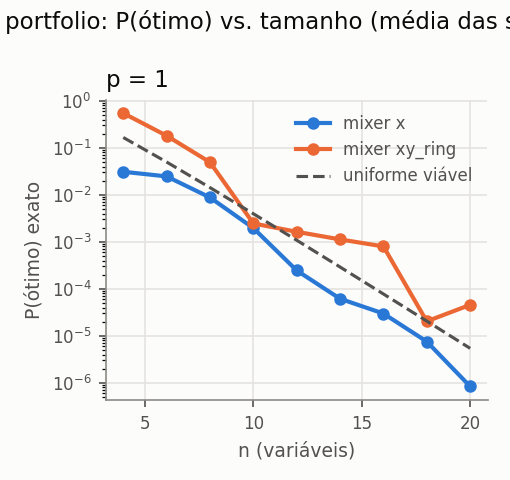
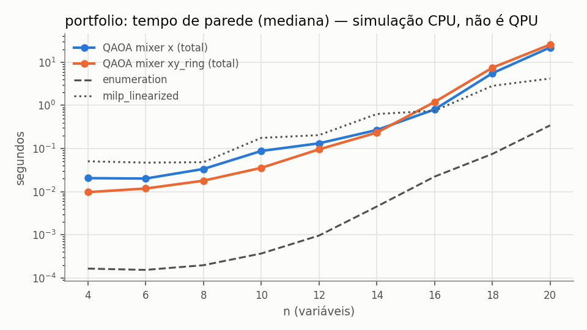

# e4_scalability — resumo gerado de `records.jsonl`

- run_id: `20261015T214902Z-fe781a` · kind: `algorithm_benchmark` · track: `algorithm_benchmark`
- commit: `2b5c85f7ea3d7142eb7ed6b7660e1482b2fcd450` (working tree suja: False)
- config_hash: `747721100e78d224` · registros: 297 · tempo de parede: 867.8s · modo quick: False
- Python 3.10.8 · qiskit 1.4.6 · qiskit-aer 0.17.2 · GPU: host_has_nvidia_gpu_but_qiskit_aer_build_is_cpu_only
- Toda execução quântica aqui é SIMULAÇÃO em CPU (`is_real_hardware=false`), salvo indicação explícita.
### Baselines clássicos (mesmo objetivo)

| domain | n | algorithm | runs | taxa_ótimo | gap_abs_médio | P(ótimo)_amostra | tempo_s_médio |
|---|---|---|---|---|---|---|---|
| portfolio | 4 | enumeration | 3 | 1.0000 | 0.0000 | — | 1.75e-04 |
| portfolio | 4 | lp_relaxation_mccormick | 3 | — | — | — | 0.0307 |
| portfolio | 4 | milp_linearized | 3 | 1.0000 | -5.78e-19 | — | 0.0811 |
| portfolio | 4 | random_feasible_sampling | 3 | 1.0000 | 0.0000 | 0.1693 | 0.0162 |
| portfolio | 4 | simulated_annealing | 3 | 1.0000 | -5.78e-19 | — | 0.0885 |
| portfolio | 6 | enumeration | 3 | 1.0000 | 0.0000 | — | 1.55e-04 |
| portfolio | 6 | lp_relaxation_mccormick | 3 | — | — | — | 0.0462 |
| portfolio | 6 | milp_linearized | 3 | 1.0000 | 0.0000 | — | 0.0474 |
| portfolio | 6 | random_feasible_sampling | 3 | 1.0000 | 0.0000 | 0.0488 | 0.0164 |
| portfolio | 6 | simulated_annealing | 3 | 1.0000 | 0.0000 | — | 0.0933 |
| portfolio | 8 | enumeration | 3 | 1.0000 | 0.0000 | — | 2.03e-04 |
| portfolio | 8 | lp_relaxation_mccormick | 3 | — | — | — | 0.0309 |
| portfolio | 8 | milp_linearized | 3 | 1.0000 | -5.78e-19 | — | 0.0676 |
| portfolio | 8 | random_feasible_sampling | 3 | 1.0000 | 0.0000 | 0.0137 | 0.0161 |
| portfolio | 8 | simulated_annealing | 3 | 1.0000 | -5.78e-19 | — | 0.0926 |
| portfolio | 10 | enumeration | 3 | 1.0000 | 0.0000 | — | 3.94e-04 |
| portfolio | 10 | lp_relaxation_mccormick | 3 | — | — | — | 0.0451 |
| portfolio | 10 | milp_linearized | 3 | 1.0000 | 0.0000 | — | 0.1721 |
| portfolio | 10 | random_feasible_sampling | 3 | 1.0000 | 0.0000 | 0.0039 | 0.0161 |
| portfolio | 10 | simulated_annealing | 3 | 1.0000 | 0.0000 | — | 0.0994 |
| portfolio | 12 | enumeration | 3 | 1.0000 | 0.0000 | — | 9.60e-04 |
| portfolio | 12 | lp_relaxation_mccormick | 3 | — | — | — | 0.0513 |
| portfolio | 12 | milp_linearized | 3 | 1.0000 | 1.16e-18 | — | 0.1899 |
| portfolio | 12 | random_feasible_sampling | 3 | 1.0000 | 0.0000 | 0.0013 | 0.0158 |
| portfolio | 12 | simulated_annealing | 3 | 1.0000 | 1.16e-18 | — | 0.0889 |
| portfolio | 14 | enumeration | 3 | 1.0000 | 0.0000 | — | 0.0043 |
| portfolio | 14 | lp_relaxation_mccormick | 3 | — | — | — | 0.0621 |
| portfolio | 14 | milp_linearized | 3 | 1.0000 | -2.31e-18 | — | 0.6092 |
| portfolio | 14 | random_feasible_sampling | 3 | 0.0000 | 0.0043 | 0.0000 | 0.0160 |
| portfolio | 14 | simulated_annealing | 3 | 1.0000 | -2.31e-18 | — | 0.0914 |
| portfolio | 16 | enumeration | 3 | 1.0000 | 0.0000 | — | 0.0252 |
| portfolio | 16 | lp_relaxation_mccormick | 3 | — | — | — | 0.0716 |
| portfolio | 16 | milp_linearized | 3 | 1.0000 | 6.94e-18 | — | 0.7390 |
| portfolio | 16 | random_feasible_sampling | 3 | 0.0000 | 0.0047 | 0.0000 | 0.0179 |
| portfolio | 16 | simulated_annealing | 3 | 1.0000 | 6.94e-18 | — | 0.0977 |
| portfolio | 18 | enumeration | 3 | 1.0000 | 0.0000 | — | 0.0735 |
| portfolio | 18 | lp_relaxation_mccormick | 3 | — | — | — | 0.0761 |
| portfolio | 18 | milp_linearized | 3 | 1.0000 | 6.94e-18 | — | 2.6414 |
| portfolio | 18 | random_feasible_sampling | 3 | 0.0000 | 0.0058 | 0.0000 | 0.0173 |
| portfolio | 18 | simulated_annealing | 3 | 1.0000 | 6.94e-18 | — | 0.0943 |
| portfolio | 20 | enumeration | 3 | 1.0000 | 0.0000 | — | 0.3373 |
| portfolio | 20 | lp_relaxation_mccormick | 3 | — | — | — | 0.1010 |
| portfolio | 20 | milp_linearized | 3 | 1.0000 | 1.85e-17 | — | 3.7862 |
| portfolio | 20 | random_feasible_sampling | 3 | 0.0000 | 0.0128 | 0.0000 | 0.0199 |
| portfolio | 20 | simulated_annealing | 3 | 1.0000 | 1.85e-17 | — | 0.1064 |

### QAOA (simulação ideal exata + amostragem finita)

`÷ uniforme viável` = P(ótimo) exato dividido pela probabilidade de sortear um ótimo uniformemente entre as C(n,k) seleções viáveis (baseline aleatório). Valores ≤ 1 significam que o circuito não concentrou probabilidade no ótimo. `runs` = execuções; `indep.` = otimizações distintas (pseudo-réplicas removidas das métricas exatas e do IC). `melhor amostra ótima` = fração de execuções cuja melhor amostra viável é ótima — compare com `random_feasible_sampling`, que usa o MESMO número de amostras.

| domain | n | algorithm | p | runs | indep. | P(ótimo) exato [IC95] | ÷ uniforme viável | P(viável) exato | melhor amostra ótima | avaliações | tempo_total_s |
|---|---|---|---|---|---|---|---|---|---|---|---|
| portfolio | 4 | qaoa_x | 1 | 9 | 3 | 0.0310 [0.0075, 0.0571] | 0.1863 | 0.1728 | 1.0000 | 85.6667 | 0.0230 |
| portfolio | 4 | qaoa_xy_ring | 1 | 9 | 3 | 0.5485 [0.3868, 0.8186] | 3.2913 | 1.0000 | 1.0000 | 42.3333 | 0.0099 |
| portfolio | 6 | qaoa_x | 1 | 9 | 3 | 0.0247 [0.0222, 0.0262] | 0.4946 | 0.6686 | 1.0000 | 43 | 0.0203 |
| portfolio | 6 | qaoa_xy_ring | 1 | 9 | 3 | 0.1815 [0.0183, 0.4437] | 3.6297 | 1.0000 | 1.0000 | 39.3333 | 0.0118 |
| portfolio | 8 | qaoa_x | 1 | 9 | 3 | 0.0088 [0.0068, 0.0123] | 0.6161 | 0.6259 | 1.0000 | 38.3333 | 0.0345 |
| portfolio | 8 | qaoa_xy_ring | 1 | 9 | 3 | 0.0495 [0.0226, 0.0657] | 3.4618 | 1.0000 | 1.0000 | 74 | 0.0291 |
| portfolio | 10 | qaoa_x | 1 | 9 | 3 | 0.0020 [0.0019, 0.0020] | 0.4948 | 0.5994 | 1.0000 | 69.3333 | 0.0883 |
| portfolio | 10 | qaoa_xy_ring | 1 | 9 | 3 | 0.0025 [0.0002, 0.0061] | 0.6209 | 1.0000 | 0.6667 | 37 | 0.0447 |
| portfolio | 12 | qaoa_x | 1 | 9 | 3 | 0.0002 [0.0002, 0.0003] | 0.2273 | 0.2259 | 0.1111 | 45.3333 | 0.1466 |
| portfolio | 12 | qaoa_xy_ring | 1 | 9 | 3 | 0.0016 [0.0003, 0.0038] | 1.5123 | 1.0000 | 0.7778 | 49.3333 | 0.1161 |
| portfolio | 14 | qaoa_x | 1 | 9 | 3 | 0.0001 [0.0000, 0.0001] | 0.2110 | 0.2096 | 0.0000 | 70 | 0.4458 |
| portfolio | 14 | qaoa_xy_ring | 1 | 9 | 3 | 0.0011 [0.0000, 0.0027] | 3.8708 | 1.0000 | 0.6667 | 39.3333 | 0.2569 |
| portfolio | 16 | qaoa_x | 1 | 9 | 3 | 0.0000 [0.0000, 0.0000] | 0.3835 | 0.3833 | 0.0000 | 26 | 0.8539 |
| portfolio | 16 | qaoa_xy_ring | 1 | 9 | 3 | 0.0008 [0.0003, 0.0013] | 10.2782 | 1.0000 | 0.7778 | 40.3333 | 1.1867 |
| portfolio | 18 | qaoa_x | 1 | 9 | 3 | 0.0000 [0.0000, 0.0000] | 0.3664 | 0.3647 | 0.0000 | 29.6667 | 5.7060 |
| portfolio | 18 | qaoa_xy_ring | 1 | 9 | 3 | 0.0000 [0.0000, 0.0000] | 0.9892 | 1.0000 | 0.1111 | 77.6667 | 11.9616 |
| portfolio | 20 | qaoa_x | 1 | 9 | 3 | 0.0000 [0.0000, 0.0000] | 0.1547 | 0.1547 | 0.0000 | 55.3333 | 38.3642 |
| portfolio | 20 | qaoa_xy_ring | 1 | 9 | 3 | 0.0000 [0.0000, 0.0001] | 8.4327 | 1.0000 | 0.0000 | 55.6667 | 33.1881 |

### Recursos (QAOA)

| domain | n | algorithm | runs | statevector_teórico_MB | pico_tracemalloc_MB | tempo_otimização_s | 2Q_lógicas_total |
|---|---|---|---|---|---|---|---|
| portfolio | 4 | qaoa_x | 9 | 2.44e-04 | 0.0563 | 0.0195 | 6 |
| portfolio | 4 | qaoa_xy_ring | 9 | 2.44e-04 | 0.0212 | 0.0067 | 14 |
| portfolio | 6 | qaoa_x | 9 | 9.77e-04 | 0.0857 | 0.0133 | 15 |
| portfolio | 6 | qaoa_xy_ring | 9 | 9.77e-04 | 0.0896 | 0.0073 | 27 |
| portfolio | 8 | qaoa_x | 9 | 0.0039 | 0.2872 | 0.0149 | 28 |
| portfolio | 8 | qaoa_xy_ring | 9 | 0.0039 | 0.3044 | 0.0191 | 44 |
| portfolio | 10 | qaoa_x | 9 | 0.0156 | 0.3872 | 0.0378 | 45 |
| portfolio | 10 | qaoa_xy_ring | 9 | 0.0156 | 0.4657 | 0.0148 | 65 |
| portfolio | 12 | qaoa_x | 9 | 0.0625 | 0.9492 | 0.0476 | 66 |
| portfolio | 12 | qaoa_xy_ring | 9 | 0.0625 | 1.3250 | 0.0421 | 90 |
| portfolio | 14 | qaoa_x | 9 | 0.2500 | 4.2589 | 0.2722 | 91 |
| portfolio | 14 | qaoa_xy_ring | 9 | 0.2500 | 6.0136 | 0.1097 | 119 |
| portfolio | 16 | qaoa_x | 9 | 1.0000 | 19.0098 | 0.4858 | 120 |
| portfolio | 16 | qaoa_xy_ring | 9 | 1.0000 | 27.0130 | 0.7999 | 152 |
| portfolio | 18 | qaoa_x | 9 | 4.0000 | 84.0108 | 4.5367 | 153 |
| portfolio | 18 | qaoa_xy_ring | 9 | 4.0000 | 120.0147 | 10.6541 | 189 |
| portfolio | 20 | qaoa_x | 9 | 16.0000 | 368.0121 | 33.6041 | 190 |
| portfolio | 20 | qaoa_xy_ring | 9 | 16.0000 | 528.0161 | 28.6254 | 230 |

