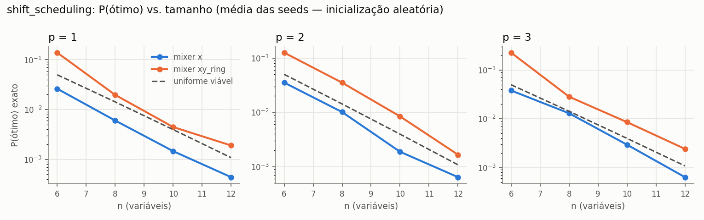
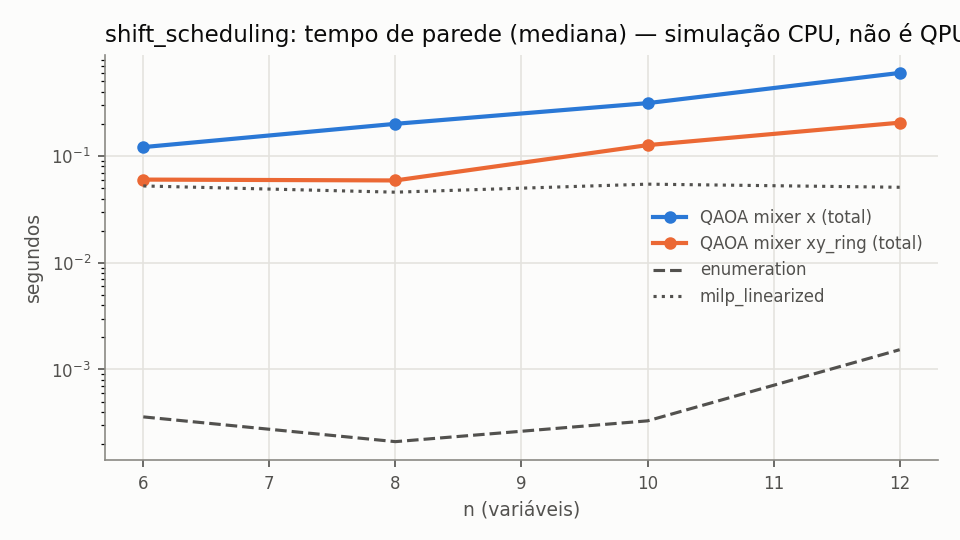

# e7_scheduling — resumo gerado de `records.jsonl`

- run_id: `20261015T192954Z-828756` · kind: `algorithm_benchmark` · track: `algorithm_benchmark`
- commit: `fc936b306ae185aba003a6ff2933b24877c54ceb` (working tree suja: False)
- config_hash: `42f4ced24447df17` · registros: 1716 · tempo de parede: 309.7s · modo quick: False
- Python 3.10.8 · qiskit 1.4.6 · qiskit-aer 0.17.2 · GPU: host_has_nvidia_gpu_but_qiskit_aer_build_is_cpu_only
- Toda execução quântica aqui é SIMULAÇÃO em CPU (`is_real_hardware=false`), salvo indicação explícita.
### Baselines clássicos (mesmo objetivo)

| domain | n | algorithm | runs | taxa_ótimo | gap_abs_médio | P(ótimo)_amostra | tempo_s_médio |
|---|---|---|---|---|---|---|---|
| shift_scheduling | 6 | enumeration | 3 | 1.0000 | 0.0000 | — | 3.44e-04 |
| shift_scheduling | 6 | lp_relaxation_mccormick | 3 | — | — | — | 0.0318 |
| shift_scheduling | 6 | milp_linearized | 3 | 1.0000 | 0.0000 | — | 0.0888 |
| shift_scheduling | 6 | random_feasible_sampling | 30 | 1.0000 | 0.0000 | 0.0498 | 0.0154 |
| shift_scheduling | 6 | simulated_annealing | 30 | 1.0000 | 0.0000 | — | 0.0853 |
| shift_scheduling | 8 | enumeration | 3 | 1.0000 | 0.0000 | — | 2.11e-04 |
| shift_scheduling | 8 | lp_relaxation_mccormick | 3 | — | — | — | 0.0293 |
| shift_scheduling | 8 | milp_linearized | 3 | 1.0000 | -2.96e-16 | — | 0.0651 |
| shift_scheduling | 8 | random_feasible_sampling | 30 | 1.0000 | 0.0000 | 0.0150 | 0.0149 |
| shift_scheduling | 8 | simulated_annealing | 30 | 1.0000 | -2.96e-16 | — | 0.0827 |
| shift_scheduling | 10 | enumeration | 3 | 1.0000 | 0.0000 | — | 3.61e-04 |
| shift_scheduling | 10 | lp_relaxation_mccormick | 3 | — | — | — | 0.0315 |
| shift_scheduling | 10 | milp_linearized | 3 | 1.0000 | 0.0000 | — | 0.0551 |
| shift_scheduling | 10 | random_feasible_sampling | 30 | 0.9333 | 0.0057 | 0.0039 | 0.0148 |
| shift_scheduling | 10 | simulated_annealing | 30 | 1.0000 | 0.0000 | — | 0.0834 |
| shift_scheduling | 12 | enumeration | 3 | 1.0000 | 0.0000 | — | 0.0014 |
| shift_scheduling | 12 | lp_relaxation_mccormick | 3 | — | — | — | 0.0313 |
| shift_scheduling | 12 | milp_linearized | 3 | 1.0000 | 2.96e-16 | — | 0.0522 |
| shift_scheduling | 12 | random_feasible_sampling | 30 | 0.7000 | 0.0916 | 0.0010 | 0.0146 |
| shift_scheduling | 12 | simulated_annealing | 30 | 1.0000 | 2.96e-16 | — | 0.0818 |

### QAOA (simulação ideal exata + amostragem finita)

`÷ uniforme viável` = P(ótimo) exato dividido pela probabilidade de sortear um ótimo uniformemente entre as C(n,k) seleções viáveis (baseline aleatório). Valores ≤ 1 significam que o circuito não concentrou probabilidade no ótimo. `runs` = execuções; `indep.` = otimizações distintas (pseudo-réplicas removidas das métricas exatas e do IC). `melhor amostra ótima` = fração de execuções cuja melhor amostra viável é ótima — compare com `random_feasible_sampling`, que usa o MESMO número de amostras.

| domain | n | algorithm | p | init_strategy | runs | indep. | P(ótimo) exato [IC95] | ÷ uniforme viável | P(viável) exato | melhor amostra ótima | avaliações | tempo_total_s |
|---|---|---|---|---|---|---|---|---|---|---|---|---|
| shift_scheduling | 6 | qaoa_x | 1 | linear_ramp | 30 | 3 | 0.0197 [0.0043, 0.0292] | 0.3938 | 0.4490 | 1.0000 | 295.3333 | 0.0886 |
| shift_scheduling | 6 | qaoa_x | 1 | random | 30 | 30 | 0.0263 [0.0231, 0.0294] | 0.5252 | 0.5195 | 1.0000 | 71.8667 | 0.0265 |
| shift_scheduling | 6 | qaoa_x | 2 | linear_ramp | 30 | 3 | 0.0492 [0.0489, 0.0496] | 0.9848 | 0.9911 | 1.0000 | 262 | 0.1354 |
| shift_scheduling | 6 | qaoa_x | 2 | random | 30 | 30 | 0.0353 [0.0301, 0.0402] | 0.7059 | 0.6726 | 1.0000 | 214.7333 | 0.1083 |
| shift_scheduling | 6 | qaoa_x | 3 | linear_ramp | 30 | 3 | 0.0493 [0.0485, 0.0497] | 0.9857 | 0.9609 | 1.0000 | 266.6667 | 0.1862 |
| shift_scheduling | 6 | qaoa_x | 3 | random | 30 | 30 | 0.0381 [0.0324, 0.0442] | 0.7625 | 0.6363 | 1.0000 | 282.0667 | 0.2159 |
| shift_scheduling | 6 | qaoa_xy_ring | 1 | linear_ramp | 30 | 3 | 0.2146 [0.0672, 0.4037] | 4.2916 | 1.0000 | 1.0000 | 49.6667 | 0.0136 |
| shift_scheduling | 6 | qaoa_xy_ring | 1 | random | 30 | 30 | 0.1392 [0.1138, 0.1712] | 2.7831 | 1.0000 | 1.0000 | 86.1667 | 0.0199 |
| shift_scheduling | 6 | qaoa_xy_ring | 2 | linear_ramp | 30 | 3 | 0.2342 [0.0196, 0.5455] | 4.6833 | 1.0000 | 1.0000 | 193.6667 | 0.0618 |
| shift_scheduling | 6 | qaoa_xy_ring | 2 | random | 30 | 30 | 0.1255 [0.0911, 0.1707] | 2.5093 | 1.0000 | 1.0000 | 203.3667 | 0.0605 |
| shift_scheduling | 6 | qaoa_xy_ring | 3 | linear_ramp | 30 | 3 | 0.2894 [0.1185, 0.5553] | 5.7885 | 1.0000 | 1.0000 | 252 | 0.0989 |
| shift_scheduling | 6 | qaoa_xy_ring | 3 | random | 30 | 30 | 0.2277 [0.1622, 0.2983] | 4.5537 | 1.0000 | 1.0000 | 282.5667 | 0.1117 |
| shift_scheduling | 8 | qaoa_x | 1 | linear_ramp | 30 | 3 | 0.0039 [0.0039, 0.0039] | 0.2730 | 0.2730 | 1.0000 | 57.6667 | 0.0414 |
| shift_scheduling | 8 | qaoa_x | 1 | random | 30 | 30 | 0.0060 [0.0051, 0.0070] | 0.4220 | 0.4337 | 1.0000 | 70.2333 | 0.0442 |
| shift_scheduling | 8 | qaoa_x | 2 | linear_ramp | 30 | 3 | 0.0129 [0.0127, 0.0130] | 0.8999 | 0.8183 | 1.0000 | 110.6667 | 0.0843 |
| shift_scheduling | 8 | qaoa_x | 2 | random | 30 | 30 | 0.0101 [0.0089, 0.0115] | 0.7088 | 0.6623 | 1.0000 | 236.1000 | 0.1688 |
| shift_scheduling | 8 | qaoa_x | 3 | linear_ramp | 30 | 3 | 0.0078 [0.0055, 0.0119] | 0.5495 | 0.6610 | 1.0000 | 300 | 0.3033 |
| shift_scheduling | 8 | qaoa_x | 3 | random | 30 | 30 | 0.0130 [0.0117, 0.0144] | 0.9097 | 0.7533 | 1.0000 | 296.5333 | 0.3049 |
| shift_scheduling | 8 | qaoa_xy_ring | 1 | linear_ramp | 30 | 3 | 0.0516 [0.0221, 0.0970] | 3.6107 | 1.0000 | 1.0000 | 40.3333 | 0.0169 |
| shift_scheduling | 8 | qaoa_xy_ring | 1 | random | 30 | 30 | 0.0197 [0.0154, 0.0259] | 1.3815 | 1.0000 | 1.0000 | 49.4667 | 0.0192 |
| shift_scheduling | 8 | qaoa_xy_ring | 2 | linear_ramp | 30 | 3 | 0.0933 [0.0352, 0.1778] | 6.5333 | 1.0000 | 1.0000 | 161 | 0.0653 |
| shift_scheduling | 8 | qaoa_xy_ring | 2 | random | 30 | 30 | 0.0352 [0.0217, 0.0514] | 2.4623 | 1.0000 | 0.9667 | 167.1000 | 0.0696 |
| shift_scheduling | 8 | qaoa_xy_ring | 3 | linear_ramp | 30 | 3 | 0.1235 [0.0006, 0.2091] | 8.6479 | 1.0000 | 0.8333 | 244.3333 | 0.1374 |
| shift_scheduling | 8 | qaoa_xy_ring | 3 | random | 30 | 30 | 0.0284 [0.0216, 0.0359] | 1.9908 | 1.0000 | 1.0000 | 274.1333 | 0.1459 |
| shift_scheduling | 10 | qaoa_x | 1 | linear_ramp | 30 | 3 | 0.0018 [0.0015, 0.0021] | 0.4639 | 0.5324 | 0.8333 | 135 | 0.1198 |
| shift_scheduling | 10 | qaoa_x | 1 | random | 30 | 30 | 0.0015 [0.0011, 0.0018] | 0.3693 | 0.3852 | 0.6667 | 83.0333 | 0.0937 |
| shift_scheduling | 10 | qaoa_x | 2 | linear_ramp | 30 | 3 | 0.0022 [0.0022, 0.0022] | 0.5540 | 0.5594 | 0.8667 | 128.6667 | 0.1737 |
| shift_scheduling | 10 | qaoa_x | 2 | random | 30 | 30 | 0.0019 [0.0016, 0.0021] | 0.4745 | 0.5659 | 0.8667 | 245.8000 | 0.2793 |
| shift_scheduling | 10 | qaoa_x | 3 | linear_ramp | 30 | 3 | 0.0032 [0.0029, 0.0037] | 0.8116 | 0.7104 | 1.0000 | 300 | 0.4606 |
| shift_scheduling | 10 | qaoa_x | 3 | random | 30 | 30 | 0.0029 [0.0024, 0.0035] | 0.7422 | 0.5731 | 0.8333 | 299.1667 | 0.4611 |
| shift_scheduling | 10 | qaoa_xy_ring | 1 | linear_ramp | 30 | 3 | 0.0247 [0.0062, 0.0489] | 6.2276 | 1.0000 | 1.0000 | 42.6667 | 0.0345 |
| shift_scheduling | 10 | qaoa_xy_ring | 1 | random | 30 | 30 | 0.0045 [0.0019, 0.0082] | 1.1263 | 1.0000 | 0.7667 | 78.5667 | 0.0484 |
| shift_scheduling | 10 | qaoa_xy_ring | 2 | linear_ramp | 30 | 3 | 0.0174 [0.0146, 0.0210] | 4.3823 | 1.0000 | 1.0000 | 123.6667 | 0.0875 |
| shift_scheduling | 10 | qaoa_xy_ring | 2 | random | 30 | 30 | 0.0084 [0.0063, 0.0106] | 2.1223 | 1.0000 | 0.8667 | 191.9000 | 0.1310 |
| shift_scheduling | 10 | qaoa_xy_ring | 3 | linear_ramp | 30 | 3 | 0.0272 [0.0120, 0.0356] | 6.8493 | 1.0000 | 1.0000 | 262.3333 | 0.2178 |
| shift_scheduling | 10 | qaoa_xy_ring | 3 | random | 30 | 30 | 0.0086 [0.0060, 0.0115] | 2.1555 | 1.0000 | 0.8333 | 273.9000 | 0.2374 |
| shift_scheduling | 12 | qaoa_x | 1 | linear_ramp | 30 | 3 | 0.0002 [0.0002, 0.0002] | 0.2254 | 0.2254 | 0.2000 | 27.6667 | 0.1172 |
| shift_scheduling | 12 | qaoa_x | 1 | random | 30 | 30 | 0.0004 [0.0004, 0.0005] | 0.4063 | 0.4347 | 0.2667 | 74.4667 | 0.1555 |
| shift_scheduling | 12 | qaoa_x | 2 | linear_ramp | 30 | 3 | 0.0006 [0.0005, 0.0006] | 0.5091 | 0.5583 | 0.3333 | 190.6667 | 0.4291 |
| shift_scheduling | 12 | qaoa_x | 2 | random | 30 | 30 | 0.0006 [0.0005, 0.0008] | 0.5935 | 0.5193 | 0.3000 | 245.2667 | 0.5221 |
| shift_scheduling | 12 | qaoa_x | 3 | linear_ramp | 30 | 3 | 0.0003 [0.0000, 0.0005] | 0.3192 | 0.3878 | 0.2000 | 300 | 0.8681 |
| shift_scheduling | 12 | qaoa_x | 3 | random | 30 | 30 | 0.0006 [0.0005, 0.0008] | 0.5877 | 0.5878 | 0.3667 | 289.2667 | 0.8498 |
| shift_scheduling | 12 | qaoa_xy_ring | 1 | linear_ramp | 30 | 3 | 0.0120 [0.0054, 0.0159] | 11.0660 | 1.0000 | 1.0000 | 37.6667 | 0.0715 |
| shift_scheduling | 12 | qaoa_xy_ring | 1 | random | 30 | 30 | 0.0019 [0.0008, 0.0034] | 1.7584 | 1.0000 | 0.5000 | 51.5333 | 0.0916 |
| shift_scheduling | 12 | qaoa_xy_ring | 2 | linear_ramp | 30 | 3 | 0.0149 [0.0071, 0.0202] | 13.8062 | 1.0000 | 1.0000 | 218.6667 | 0.3065 |
| shift_scheduling | 12 | qaoa_xy_ring | 2 | random | 30 | 30 | 0.0017 [0.0007, 0.0031] | 1.5371 | 1.0000 | 0.5333 | 161.3667 | 0.2516 |
| shift_scheduling | 12 | qaoa_xy_ring | 3 | linear_ramp | 30 | 3 | 0.0214 [0.0007, 0.0368] | 19.8035 | 1.0000 | 0.8667 | 243.6667 | 0.4803 |
| shift_scheduling | 12 | qaoa_xy_ring | 3 | random | 30 | 30 | 0.0024 [0.0016, 0.0034] | 2.2335 | 1.0000 | 0.8333 | 277.4667 | 0.5584 |

### Recursos (QAOA)

| domain | n | algorithm | runs | statevector_teórico_MB | pico_tracemalloc_MB | tempo_otimização_s | 2Q_lógicas_total |
|---|---|---|---|---|---|---|---|
| shift_scheduling | 6 | qaoa_x | 180 | 9.77e-04 | 0.1126 | 0.1205 | 30 |
| shift_scheduling | 6 | qaoa_xy_ring | 180 | 9.77e-04 | 0.0881 | 0.0568 | 32.6667 |
| shift_scheduling | 8 | qaoa_x | 180 | 0.0039 | 0.2870 | 0.1399 | 56 |
| shift_scheduling | 8 | qaoa_xy_ring | 180 | 0.0039 | 0.3031 | 0.0673 | 53.3333 |
| shift_scheduling | 10 | qaoa_x | 180 | 0.0156 | 0.3868 | 0.2165 | 90 |
| shift_scheduling | 10 | qaoa_xy_ring | 180 | 0.0156 | 0.4811 | 0.1053 | 72 |
| shift_scheduling | 12 | qaoa_x | 180 | 0.0625 | 0.9469 | 0.4027 | 132 |
| shift_scheduling | 12 | qaoa_xy_ring | 180 | 0.0625 | 1.3243 | 0.2432 | 99.3333 |

